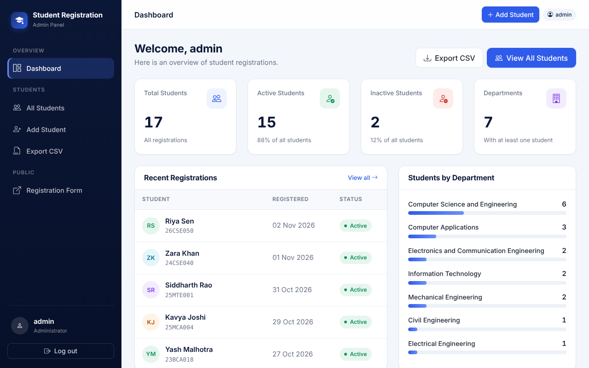
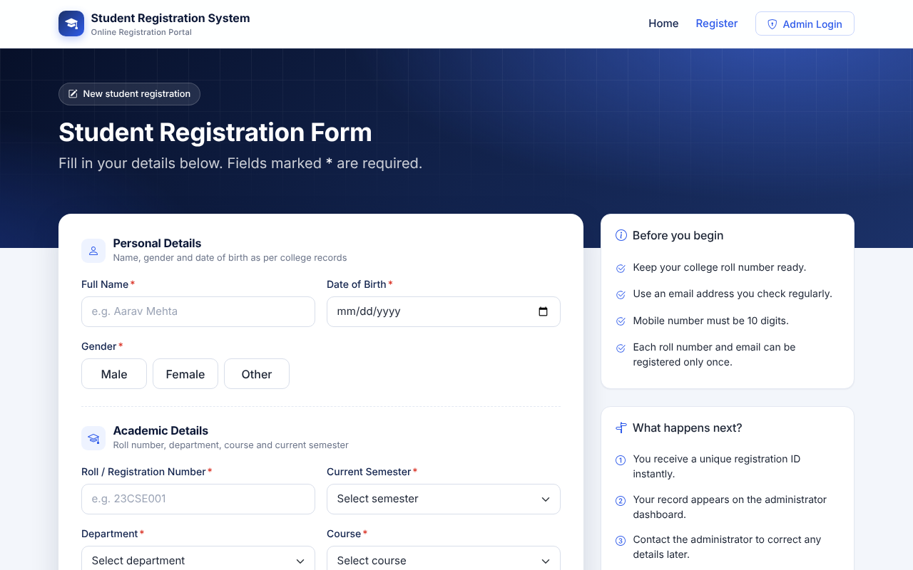
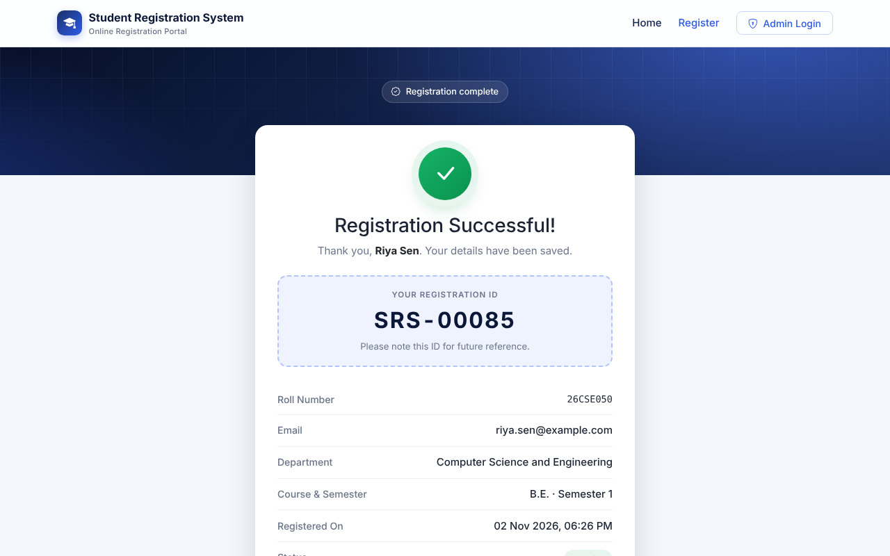
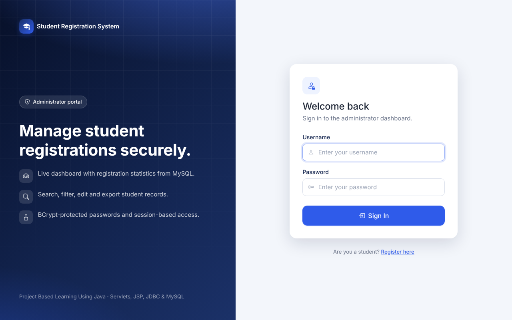
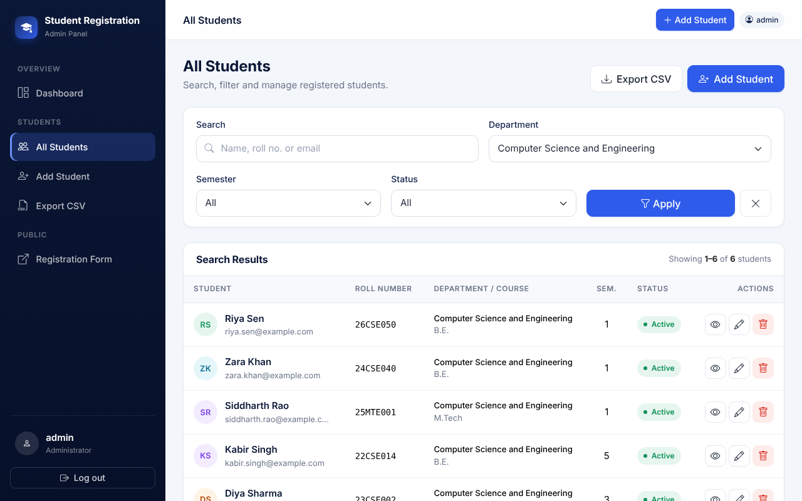
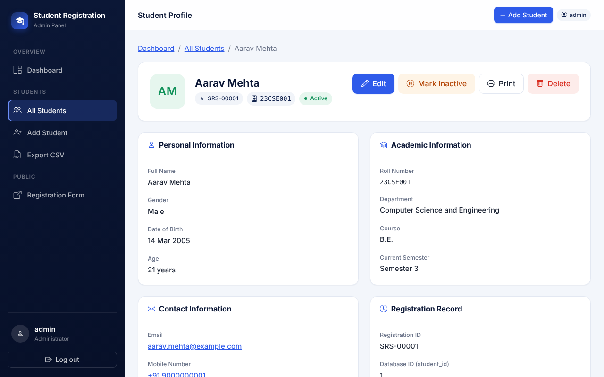
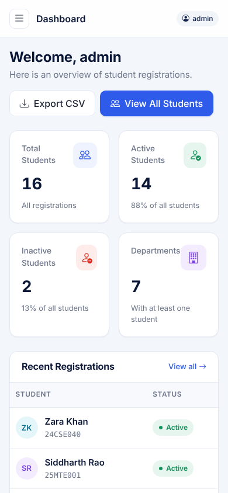

# Student Registration System

A web-based student registration and management system built with **Java Servlets, JSP, JDBC and
MySQL** on **Apache Tomcat 9**. Academic minor project for *Project Based Learning Using Java (PBLJ)*.

Students register online and instantly receive a registration ID. Administrators log in to a secure
panel to see live statistics and to search, filter, view, add, edit, delete, activate/deactivate,
print and export student records.



---

## Features

**Students (public)**
- Registration form: name, roll number, email, phone, gender, date of birth, department, course, semester, address
- Validation in the browser **and** on the server (email, phone, semester 1–8, age 15–60, lists …)
- Duplicate roll numbers and emails rejected (Java check + MySQL UNIQUE constraints)
- Automatically generated registration ID (e.g. `SRS-00017`) and printable confirmation

**Administrators**
- Secure login (BCrypt-hashed passwords, session-based, 30-minute timeout, logout)
- Dashboard: total, active, inactive, departments, recent registrations, students per department — all from live SQL
- Student list with paging, search (name / roll number / email) and filters (department / semester / status)
- Profile, add, edit, delete (with confirmation), Active/Inactive status, CSV export, print-friendly profile
- Success/error notifications, empty states, responsive layout, works offline (no CDN)

**Security:** PreparedStatement everywhere · server-side validation · BCrypt · `AuthFilter` on `/admin/*` ·
CSRF tokens · POST-only changes · output escaping (XSS) · HttpOnly/SameSite cookies · anti-clickjacking
header · friendly error pages · no secrets in Git.

## Screenshots

| Registration | Registration success |
|---|---|
|  |  |
| **Admin login** | **All students (search & filters)** |
|  |  |
| **Student profile** | **Mobile view** |
|  |  |

<sub>Screenshots captured from this application during development testing, using the fictional sample data.</sub>

## Technology stack

| Component | Technology |
|---|---|
| Language | Java 17 |
| Web layer | Java Servlets 4.0 (`javax.servlet`), JSP 2.3, JSTL 1.2 |
| Frontend | HTML, CSS, JavaScript, Bootstrap 5.3, Bootstrap Icons (bundled locally) |
| Database | MySQL 8 via JDBC (MySQL Connector/J 8.4) |
| Password hashing | jBCrypt 0.4 |
| Server | Apache Tomcat 9 |
| Build | Maven (WAR packaging) |
| Tests | JUnit 5, Bash + curl functional test script |
| Architecture | MVC + DAO |

## Quick start

Full step-by-step instructions for Windows and macOS: **[docs/SETUP_AND_EXECUTION.md](docs/SETUP_AND_EXECUTION.md)**.

Prerequisites: JDK 17, Maven 3.8+, MySQL 8.0, Apache Tomcat **9** (not 10/11), Git.

```bash
git clone git@github.com:Nikhilnmv/PBLJ-Laxita.git
cd PBLJ-Laxita
```

1. **Create the database** (asks for the MySQL root password):
   ```bash
   mysql -u root -p < database/schema.sql
   mysql -u root -p < database/sample_data.sql
   ```
   Then create an application user (in the `mysql` client):
   ```sql
   CREATE USER 'srs_app'@'localhost' IDENTIFIED BY 'Choose-A-Strong-Password1';
   GRANT SELECT, INSERT, UPDATE, DELETE ON student_registration_db.* TO 'srs_app'@'localhost';
   ```
2. **Configure the connection** — copy the example file and put your password in the copy:
   ```bash
   cp src/main/resources/db.properties.example src/main/resources/db.properties
   ```
   (`db.properties` is git-ignored. Environment variables `DB_URL`, `DB_USER`, `DB_PASSWORD` also work.)
3. **Create the administrator account** (password is hashed with BCrypt; nothing is stored in Git):
   ```bash
   mvn compile exec:java
   ```
4. **Build:**
   ```bash
   mvn clean package
   ```
5. **Deploy:** copy `target/student-registration.war` to `<TOMCAT>/webapps/`, start Tomcat
   (`bin/startup.sh` or `bin\startup.bat`) and open **<http://localhost:8080/student-registration/>**.

## Project structure

```
├── pom.xml                         Maven build (dependencies, Java 17, WAR)
├── database/                       schema.sql, sample_data.sql (fictional data)
├── scripts/functional-test.sh      67 automated HTTP checks (curl)
├── src/main/java/com/student/
│   ├── model/                      Student, Admin, StudentFilter            (Model)
│   ├── dao/                        StudentDAO, AdminDAO, DuplicateStudentException (DAO)
│   ├── servlet/                    12 servlets + StudentRequestHelper       (Controller)
│   ├── filter/                     AuthFilter (protects /admin/*)
│   ├── listener/                   AppContextListener (start-up DB check)
│   └── util/                       DBConnection, ValidationUtil, PasswordUtil, CsrfUtil,
│                                   CsvUtil, AppConstants, AdminSetup
├── src/main/resources/             db.properties.example
├── src/main/webapp/
│   ├── index.jsp, assets/          home page, CSS, JS, Bootstrap, icons, font
│   └── WEB-INF/                    web.xml, views/ (JSP pages and fragments)  (View)
├── src/test/java/                  JUnit unit + integration tests
└── docs/                           documentation, diagrams (Mermaid + PNG/SVG)
```

## Testing

```bash
mvn test                              # 28 unit tests
mvn test -Dintegration=true           # + 15 integration tests against MySQL
ADMIN_PASSWORD='your-admin-password' ./scripts/functional-test.sh   # 67 HTTP checks (app must be running)
```
Results, including performance with 10,000 students: [docs/TEST_RESULTS.md](docs/TEST_RESULTS.md).

## Documentation

| Document | Contents |
|---|---|
| [SETUP_AND_EXECUTION](docs/SETUP_AND_EXECUTION.md) | Installation, configuration, running, troubleshooting |
| [PROJECT_OVERVIEW](docs/PROJECT_OVERVIEW.md) | Problem, objectives, scope, features, limitations, future scope |
| [COMPLETE_PROJECT_GUIDE](docs/COMPLETE_PROJECT_GUIDE.md) | **Main learning guide** — how everything works |
| [CODE_WALKTHROUGH](docs/CODE_WALKTHROUGH.md) | File-by-file explanation and traced flows |
| [JAVA_CONCEPTS_USED](docs/JAVA_CONCEPTS_USED.md) | 28 Java concepts with real code from this project |
| [DATABASE_EXPLANATION](docs/DATABASE_EXPLANATION.md) | Tables, constraints, every SQL query, JDBC |
| [DATABASE_DESIGN](docs/DATABASE_DESIGN.md) | ER diagram, data dictionary, design rationale |
| [ARCHITECTURE](docs/ARCHITECTURE.md) | Architecture, MVC, component, deployment, request lifecycle |
| [SRS](docs/SRS.md) | Software requirements specification |
| [USE_CASES](docs/USE_CASES.md) | Actors, use case diagram and descriptions |
| [TEST_PLAN](docs/TEST_PLAN.md) · [TEST_CASES](docs/TEST_CASES.md) · [TEST_RESULTS](docs/TEST_RESULTS.md) · [TRACEABILITY_MATRIX](docs/TRACEABILITY_MATRIX.md) | Testing |
| [DESIGN_DECISIONS](docs/DESIGN_DECISIONS.md) | Why each technology/design was chosen, with trade-offs |
| [DEVELOPMENT_PROCESS](docs/DEVELOPMENT_PROCESS.md) | How the project was developed |
| [VIVA_PREPARATION](docs/VIVA_PREPARATION.md) | Introductions, Q&A, demo script, quick revision |
| [PROJECT_REPORT_MATERIAL](docs/PROJECT_REPORT_MATERIAL.md) · [REPORT_SCREENSHOTS_CHECKLIST](docs/REPORT_SCREENSHOTS_CHECKLIST.md) | Material for the final report |
| [diagrams/](docs/diagrams/README.md) | 15 UML, ER, DFD and architecture diagrams |

## Security note
This project is designed to run locally. Never commit `db.properties` or any password. For deployment
on a real network, HTTPS and the improvements listed in [PROJECT_OVERVIEW.md](docs/PROJECT_OVERVIEW.md#10-future-enhancements)
would be required.

## Credits
Bootstrap and Bootstrap Icons (MIT License) and the Inter font (SIL Open Font License) are included in
`src/main/webapp/assets/vendor/` with their licence files.
