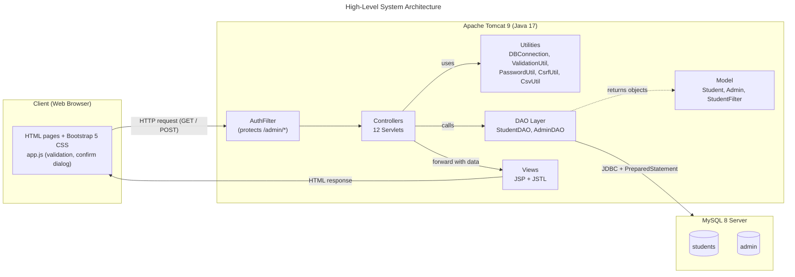
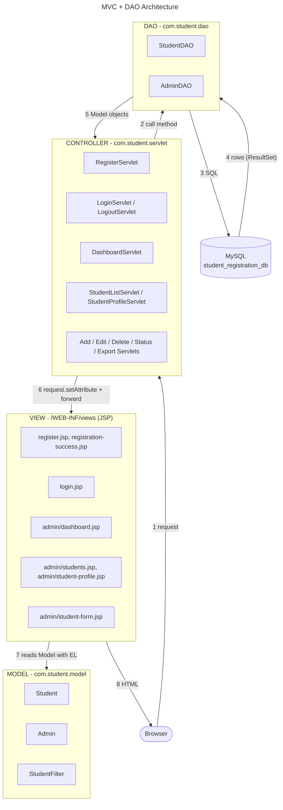
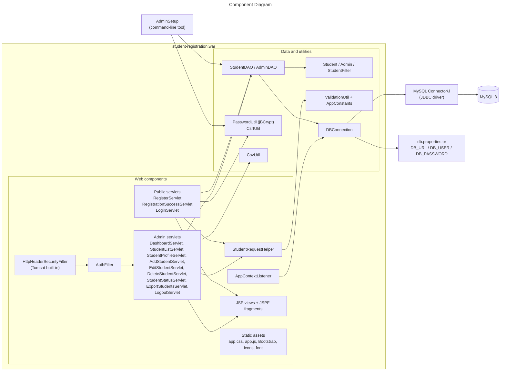
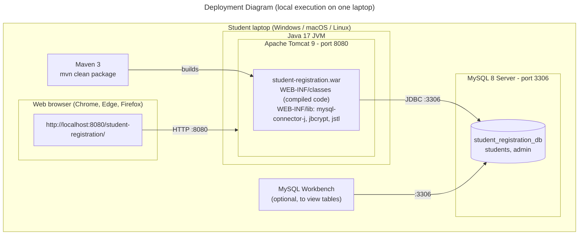
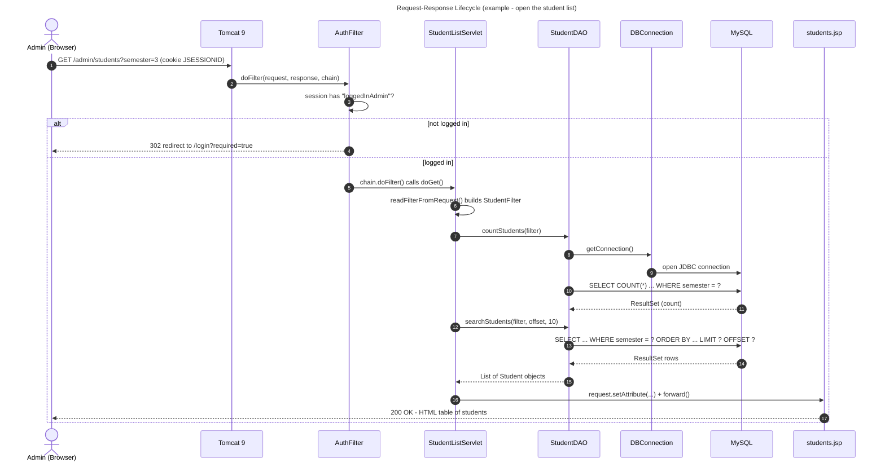

# System Architecture

The Student Registration System is a **monolithic three-tier web application** organised internally
with the **MVC + DAO** pattern.

| Tier | Runs in | Contains |
|---|---|---|
| Presentation (client) | Web browser | HTML, Bootstrap CSS, `app.js` |
| Application (server) | Apache Tomcat 9 on Java 17 | Filter, servlets, JSPs, DAOs, utilities |
| Data | MySQL 8 | `student_registration_db` (`students`, `admin`) |

All diagrams are stored as editable Mermaid sources in [`docs/diagrams/`](diagrams/) and exported
as PNG/SVG in [`docs/diagrams/exports/`](diagrams/exports/) for the report.

---

## 1. High-level system architecture

<!-- mermaid:architecture -->

_Source: [`diagrams/architecture.mmd`](diagrams/architecture.mmd) · PNG: [`exports/architecture.png`](diagrams/exports/architecture.png) · SVG: [`exports/architecture.svg`](diagrams/exports/architecture.svg)_

**Explanation.** The browser sends HTTP requests to Tomcat. Requests to `/admin/*` pass through
`AuthFilter` first. A servlet (controller) validates input with the utilities, calls a DAO, which
runs SQL through JDBC on MySQL and returns model objects. The servlet forwards those objects to a
JSP, which renders HTML for the browser.

## 2. MVC architecture

<!-- mermaid:mvc-architecture -->

_Source: [`diagrams/mvc-architecture.mmd`](diagrams/mvc-architecture.mmd) · PNG: [`exports/mvc-architecture.png`](diagrams/exports/mvc-architecture.png) · SVG: [`exports/mvc-architecture.svg`](diagrams/exports/mvc-architecture.svg)_

| Layer | Package / folder | Rule |
|---|---|---|
| Model | `com.student.model` | Plain Java objects; no SQL, no HTTP |
| View | `src/main/webapp/WEB-INF/views` | JSP + JSTL only; no Java code, no SQL |
| Controller | `com.student.servlet` | Reads requests, validates, calls DAO, picks the view |
| DAO | `com.student.dao` | The only place with SQL |
| Utilities | `com.student.util` | Shared helpers (connection, validation, hashing, CSRF, CSV) |
| Cross-cutting | `com.student.filter`, `com.student.listener` | Security filter; start-up/shut-down hooks |

## 3. Component diagram

<!-- mermaid:component-diagram -->

_Source: [`diagrams/component-diagram.mmd`](diagrams/component-diagram.mmd) · PNG: [`exports/component-diagram.png`](diagrams/exports/component-diagram.png) · SVG: [`exports/component-diagram.svg`](diagrams/exports/component-diagram.svg)_

## 4. Deployment diagram (local execution)

<!-- mermaid:deployment-diagram -->

_Source: [`diagrams/deployment-diagram.mmd`](diagrams/deployment-diagram.mmd) · PNG: [`exports/deployment-diagram.png`](diagrams/exports/deployment-diagram.png) · SVG: [`exports/deployment-diagram.svg`](diagrams/exports/deployment-diagram.svg)_

Everything runs on one laptop: the browser connects to Tomcat on port **8080**; the application
connects to MySQL on port **3306** using the restricted `srs_app` account. MySQL Workbench can be
opened beside the browser during the demo to show the stored rows.

## 5. Request–response lifecycle

<!-- mermaid:request-lifecycle -->

_Source: [`diagrams/request-lifecycle.mmd`](diagrams/request-lifecycle.mmd) · PNG: [`exports/request-lifecycle.png`](diagrams/exports/request-lifecycle.png) · SVG: [`exports/request-lifecycle.svg`](diagrams/exports/request-lifecycle.svg)_

Step by step:
1. The browser sends `GET /student-registration/admin/students?semester=3` with the `JSESSIONID` cookie.
2. Tomcat matches the context path (`/student-registration`) and runs the matching filters:
   `HttpHeaderSecurityFilter` (adds `X-Frame-Options`, `X-Content-Type-Options`) and `AuthFilter`.
3. `AuthFilter` finds `loggedInAdmin` in the session → `chain.doFilter`.
4. Tomcat calls `StudentListServlet.doGet`.
5. The servlet builds a `StudentFilter`, calls `countStudents` and `searchStudents`.
6. `StudentDAO` opens a connection (`DBConnection`), runs the prepared SQL, maps rows to `Student` objects.
7. The servlet stores the list in the request and forwards to `students.jsp`.
8. The JSP renders HTML (escaping all user data); Tomcat sends `200 OK` with the page.

For POST requests that change data, the servlet finishes with `sendRedirect` (HTTP 302) instead of
`forward` — the **Post/Redirect/Get** pattern — so refreshing the browser never repeats the change.

## 6. URL map

| URL | Method | Controller | View / result | Protected |
|---|---|---|---|---|
| `/` | GET | (welcome file) | `index.jsp` | no |
| `/register` | GET, POST | `RegisterServlet` | `register.jsp` / redirect | no |
| `/register/success` | GET | `RegistrationSuccessServlet` | `registration-success.jsp` | no |
| `/login` | GET, POST | `LoginServlet` | `login.jsp` / redirect | no |
| `/admin`, `/admin/dashboard` | GET | `DashboardServlet` | `admin/dashboard.jsp` | yes |
| `/admin/students` | GET | `StudentListServlet` | `admin/students.jsp` | yes |
| `/admin/students/view?id=` | GET | `StudentProfileServlet` | `admin/student-profile.jsp` | yes |
| `/admin/students/add` | GET, POST | `AddStudentServlet` | `admin/student-form.jsp` / redirect | yes + CSRF |
| `/admin/students/edit?id=` | GET, POST | `EditStudentServlet` | `admin/student-form.jsp` / redirect | yes + CSRF |
| `/admin/students/delete` | POST | `DeleteStudentServlet` | redirect | yes + CSRF |
| `/admin/students/status` | POST | `StudentStatusServlet` | redirect | yes + CSRF |
| `/admin/students/export` | GET | `ExportStudentsServlet` | CSV download | yes |
| `/admin/logout` | POST | `LogoutServlet` | redirect | yes + CSRF |

## 7. Security architecture

```
Browser ──> HttpHeaderSecurityFilter ──> AuthFilter (/admin/*) ──> Servlet ──> ValidationUtil ──> DAO (PreparedStatement) ──> MySQL (constraints)
              X-Frame-Options              session check           server-side       SQL injection            UNIQUE / CHECK
              nosniff                      CSRF token (POST)        validation        protection               NOT NULL
                                           no-store cache
JSP output: <c:out> / fn:escapeXml (XSS)   Cookies: HttpOnly, SameSite=Lax   Passwords: BCrypt (cost 12)
```

Defence in depth: each layer has its own protection, so one mistake does not expose the system.
Details: [COMPLETE_PROJECT_GUIDE.md, Part 6](COMPLETE_PROJECT_GUIDE.md#part-6--security-in-this-project-summary).

## 8. Error-handling architecture
- Validation problems → shown next to the form fields (HTTP 200, form re-displayed).
- Missing records → `response.sendError(404)` → `error.jsp`.
- Wrong HTTP method → 405 (inherited from `HttpServlet`) → `error.jsp`.
- Missing CSRF token → 403 from `AuthFilter` → `error.jsp`.
- Database failures → `SQLException` logged with `log(...)` and re-thrown as `ServletException` →
  500 → `error.jsp` ("Something went wrong"). Users never see stack traces; developers read
  `<TOMCAT>/logs/localhost.<date>.log`.
- `AppContextListener` logs whether MySQL is reachable at start-up.

## 9. Concurrency and scalability notes
- Tomcat handles each request on a separate thread. Servlets keep **no per-request data in fields**
  (only a stateless DAO), so they are thread-safe without `synchronized`.
- Each DAO call opens and closes its own connection — simple and safe; a connection pool would be the
  first optimisation for heavy traffic.
- Uniqueness under concurrency is guaranteed by MySQL's UNIQUE constraints, not by Java checks.
- Lists are paginated (10 rows, `LIMIT/OFFSET`) and filtered columns are indexed, so pages stay fast
  as the table grows.

## 10. Why a monolith?
One WAR file, one database, one server process — the simplest architecture that meets the
requirements, easy to run on a laptop and to explain. Reasons and trade-offs are in
[DESIGN_DECISIONS.md](DESIGN_DECISIONS.md).
