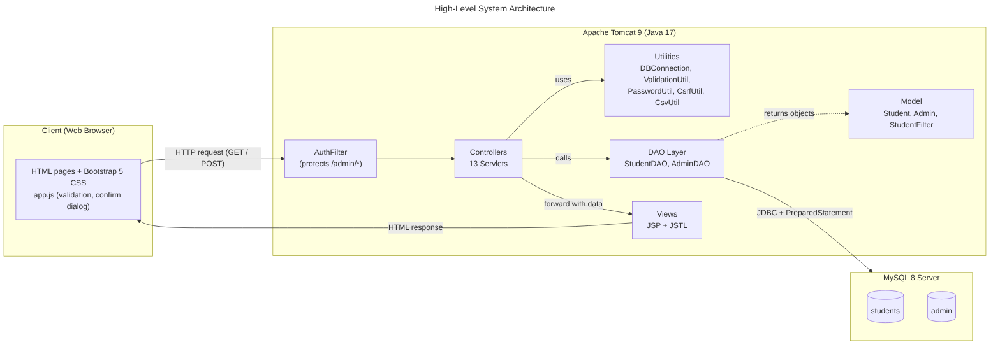
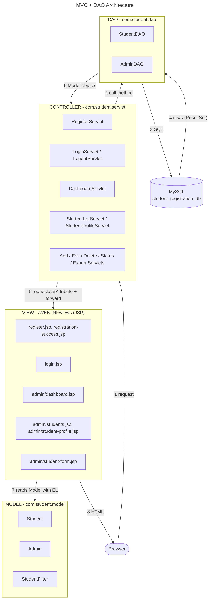

# Complete Project Guide

This is the **main learning document**. Read it from top to bottom once, with the code open beside
it. By the end you should be able to explain every part of the project — what it does, why it
exists and how the pieces talk to each other.

Other documents go deeper into single topics:
[CODE_WALKTHROUGH](CODE_WALKTHROUGH.md) (file by file),
[JAVA_CONCEPTS_USED](JAVA_CONCEPTS_USED.md),
[DATABASE_EXPLANATION](DATABASE_EXPLANATION.md),
[ARCHITECTURE](ARCHITECTURE.md),
[VIVA_PREPARATION](VIVA_PREPARATION.md).

---

## Part 1 — The big picture

### 1.1 What happens when you use the application?

1. You type `http://localhost:8080/student-registration/register` in the browser.
2. The browser sends an **HTTP request** to **Tomcat** (a program listening on port 8080).
3. Tomcat looks at the URL and calls the Java class responsible for `/register` — the
   **servlet** `RegisterServlet`.
4. The servlet prepares the data the page needs and hands over to a **JSP** file (`register.jsp`),
   which produces HTML.
5. Tomcat sends that HTML back as the **HTTP response**; the browser displays the form.
6. When you click *Submit*, the browser sends the form data in a **POST** request to the same
   servlet, which validates it, asks the **DAO** class `StudentDAO` to save it, and StudentDAO uses
   **JDBC** to run an `INSERT` statement in **MySQL**.

Everything else in the project is a variation of these six steps.



### 1.2 How the project folder is organised

```
PBLJ-Laxita/
├── start.bat / start.sh         one-click start (asks for the MySQL password the first time)
├── mvnw / mvnw.cmd              Maven Wrapper: downloads Maven automatically
├── pom.xml                      Maven build file (libraries + how to build the WAR)
├── database/
│   ├── schema.sql               CREATE DATABASE + CREATE TABLE statements
│   └── sample_data.sql          16 fictional students
├── scripts/functional-test.sh   automated HTTP tests (curl)
├── src/main/java/com/student/
│   ├── model/                   Student, Admin, StudentFilter          (MODEL)
│   ├── dao/                     StudentDAO, AdminDAO, DuplicateStudentException (DAO)
│   ├── servlet/                 13 servlets + StudentRequestHelper      (CONTROLLER)
│   ├── filter/                  AuthFilter                              (security)
│   ├── listener/                AppContextListener                      (start-up check)
│   └── util/                    DBConnection, ValidationUtil, PasswordUtil, CsrfUtil,
│                                CsvUtil, AppConstants, AdminSetup
├── src/main/resources/
│   └── db.properties.example    template for the database password file
├── src/main/webapp/
│   ├── index.jsp                home page
│   ├── assets/                  css/app.css, js/app.js, Bootstrap, icons, font, favicon
│   ├── META-INF/context.xml     Tomcat setting (SameSite cookie)
│   └── WEB-INF/
│       ├── web.xml              application settings (session timeout, error pages ...)
│       └── views/               JSP pages                                (VIEW)
│           ├── register.jsp, registration-success.jsp, login.jsp, error.jsp
│           ├── admin/  dashboard.jsp, students.jsp, student-profile.jsp, student-form.jsp
│           └── common/ reusable fragments (.jspf): head, navbar, sidebar, form fields ...
├── src/test/java/               JUnit tests
└── docs/                        all documentation and diagrams
```

**Why are the JSPs inside `WEB-INF`?** Files inside `WEB-INF` can never be opened directly by a
browser. That forces every page to go through its servlet first, so a JSP is never shown without
its data, and the admin pages can't be opened without passing the login check.

---

## Part 2 — The technologies, one by one

### 2.1 Java 17
The programming language for all server code. Version 17 is a *Long-Term Support* release, so it
is stable and installed in most colleges. The project uses modern features such as
`java.time.LocalDate`, `List.of(...)`, `String.isBlank()` and try-with-resources.

### 2.2 Maven — the build tool
Maven reads [`pom.xml`](../pom.xml) and:

1. **Downloads dependencies** (libraries) from Maven Central into `~/.m2` — you never copy JAR files by hand.
2. **Compiles** `src/main/java` for Java 17 (`<maven.compiler.release>17</maven.compiler.release>`).
3. **Runs tests** in `src/test/java`.
4. **Packages** everything into `target/student-registration.war` (`<packaging>war</packaging>`).

The dependencies in `pom.xml`:

| Library | Scope | Why |
|---|---|---|
| `javax.servlet-api 4.0.1` | provided | Servlet classes (`HttpServlet`, `HttpSession` …). *Provided* = Tomcat already has it, so it is **not** copied into the WAR |
| `javax.servlet.jsp-api 2.3.3` | provided | JSP classes, also inside Tomcat |
| `jstl 1.2` | compile | `<c:forEach>`, `<c:if>`, `<c:out>` tags for JSPs — Tomcat does not include it |
| `mysql-connector-j 8.4.0` | compile | The JDBC **driver**: translates JDBC calls into MySQL's network protocol |
| `jbcrypt 0.4` | compile | BCrypt password hashing |
| `junit-jupiter 5.11.4` | test | Unit testing, only used during `mvn test` |

The **Maven Wrapper** (`mvnw` / `mvnw.cmd`) downloads the right Maven version automatically, so
Maven does not need to be installed. The **Cargo plugin** downloads Apache Tomcat 9 and runs the WAR
in it (`mvnw package cargo:run`) — this is what `start.bat` / `start.sh` use. The `exec-maven-plugin`
runs the command-line admin tool (`mvnw compile exec:java`).

### 2.3 Apache Tomcat 9 — the web server / servlet container
Tomcat is a Java program that:
- listens for HTTP requests on port 8080,
- unpacks our WAR file into `webapps/student-registration/`,
- creates **one object** of each servlet and calls its `doGet` / `doPost` methods for each request
  (each request runs on its own thread),
- compiles JSP files into servlets automatically the first time they are used,
- manages **sessions** (remembers which browser is which using the `JSESSIONID` cookie).

Tomcat 9 implements **Servlet 4.0** with the `javax.servlet` package names this project uses.

### 2.4 Servlets — the controllers
A servlet is a Java class that extends `javax.servlet.http.HttpServlet` and handles requests for
one URL. Example from [`StudentProfileServlet.java`](../src/main/java/com/student/servlet/StudentProfileServlet.java):

```java
@WebServlet("/admin/students/view")
public class StudentProfileServlet extends HttpServlet {

    private final StudentDAO studentDAO = new StudentDAO();

    @Override
    protected void doGet(HttpServletRequest request, HttpServletResponse response)
            throws ServletException, IOException {

        int studentId = StudentRequestHelper.readPositiveInt(request, "id");
        ...
        Student student = studentDAO.getStudentById(studentId);
        if (student == null) {
            response.sendError(HttpServletResponse.SC_NOT_FOUND);
            return;
        }
        request.setAttribute("student", student);
        request.getRequestDispatcher("/WEB-INF/views/admin/student-profile.jsp").forward(request, response);
    }
}
```

- `@WebServlet("/admin/students/view")` tells Tomcat which URL this servlet handles (no `web.xml` entry needed).
- `doGet` runs for GET requests (opening a link); `doPost` for POST requests (submitting a form).
- `request.getParameter("id")` (inside `readPositiveInt`) reads `?id=5` from the URL.
- `request.setAttribute("student", student)` puts a Java object where the JSP can find it.
- `forward(...)` passes control to the JSP **inside the server** — the browser's URL does not change.

The 13 servlets and their URLs:

| URL | Servlet | Methods | Access |
|---|---|---|---|
| `/register` | `RegisterServlet` | GET form, POST save | public |
| `/register/success` | `RegistrationSuccessServlet` | GET | public |
| `/setup` | `SetupServlet` | GET form, POST create first admin (only while no admin exists) | public |
| `/login` | `LoginServlet` | GET form, POST check | public |
| `/admin/logout` | `LogoutServlet` | POST (GET just redirects) | admin |
| `/admin/dashboard`, `/admin` | `DashboardServlet` | GET | admin |
| `/admin/students` | `StudentListServlet` | GET | admin |
| `/admin/students/view` | `StudentProfileServlet` | GET | admin |
| `/admin/students/add` | `AddStudentServlet` | GET form, POST save | admin |
| `/admin/students/edit` | `EditStudentServlet` | GET form, POST save | admin |
| `/admin/students/delete` | `DeleteStudentServlet` | POST only | admin |
| `/admin/students/status` | `StudentStatusServlet` | POST only | admin |
| `/admin/students/export` | `ExportStudentsServlet` | GET (downloads CSV) | admin |

### 2.5 JSP and JSTL — the views
A JSP (JavaServer Page) is an HTML file with a few special tags. Tomcat turns it into a servlet
behind the scenes. In this project **JSPs contain no Java code and no SQL** — only HTML plus:

- **EL (Expression Language)** `${...}` — reads request attributes:
  `${student.fullName}` calls `student.getFullName()`.
- **JSTL core tags** — logic for display only:
  `<c:forEach>` loops, `<c:if>` / `<c:choose>` conditions, `<c:set>` variables,
  `<c:out>` prints text **safely escaped**.
- **JSTL functions** — `fn:escapeXml(...)` escapes text inside HTML attributes.

From [`admin/students.jsp`](../src/main/webapp/WEB-INF/views/admin/students.jsp):

```jsp
<c:forEach var="s" items="${students}">
    <tr>
        <td><a href="${ctx}/admin/students/view?id=${s.studentId}"><c:out value="${s.fullName}"/></a></td>
        <td class="mono"><c:out value="${s.rollNumber}"/></td>
        <td><span class="status-badge ${s.active ? 'status-active' : 'status-inactive'}"><c:out value="${s.status}"/></span></td>
        ...
```

**Fragments (`.jspf`)** are pieces shared by many pages and included with
`<%@ include file="/WEB-INF/views/common/head.jspf" %>`: the `<head>` section, navigation bar,
admin sidebar, flash messages, the confirm dialog and — importantly — `student-form-fields.jspf`,
the form fields used by **both** the public registration form and the admin add/edit form.

### 2.6 JDBC — Java Database Connectivity
JDBC is the standard Java API (`java.sql` package) for talking to relational databases. The main
interfaces are:

| JDBC type | Meaning | Used in |
|---|---|---|
| `DriverManager` | creates connections using the URL | `DBConnection.getConnection()` |
| `Connection` | an open session with MySQL | every DAO method |
| `PreparedStatement` | a pre-compiled SQL statement with `?` placeholders | every DAO method |
| `ResultSet` | the rows returned by a SELECT, read one at a time with `next()` | `mapRowToStudent(...)` |
| `SQLException` | any database error | declared by DAO methods |

The MySQL **driver** (Connector/J) is the library that implements these interfaces for MySQL.

### 2.7 MySQL — the database
MySQL stores data in **tables** made of rows and columns. This project has one database,
`student_registration_db`, with two tables (`students`, `admin`). MySQL enforces rules for us:
primary keys, `UNIQUE` columns, `NOT NULL`, `CHECK` constraints and default values. See
[DATABASE_EXPLANATION.md](DATABASE_EXPLANATION.md).

### 2.8 Bootstrap 5 and our own CSS/JS
Bootstrap gives ready-made grid, forms, tables, buttons, modal dialogs and the mobile slide-in menu.
[`assets/css/app.css`](../src/main/webapp/assets/css/app.css) adds the navy/white theme and layouts.
[`assets/js/app.js`](../src/main/webapp/assets/js/app.js) adds three small behaviours: client-side form
validation with a double-submit guard, the delete confirmation dialog, and print buttons.
Bootstrap, the icons and the font are **stored inside the project**, so the app works without internet.

---

## Part 3 — The architecture: MVC + DAO



### 3.1 MVC = Model, View, Controller
MVC splits the application into three responsibilities:

| Part | Responsibility | In this project |
|---|---|---|
| **Model** | The data and its rules | `Student`, `Admin`, `StudentFilter` (package `model`) |
| **View** | Showing data to the user | JSP files in `WEB-INF/views` |
| **Controller** | Receiving requests, deciding what to do, choosing the view | Servlets (package `servlet`) |

**Why?** Each file has one job, so it is easier to read, test and change. A designer can change a
JSP without touching Java; the database code can change without touching any page.

### 3.2 DAO = Data Access Object
The DAO pattern adds one more layer: **all SQL lives in DAO classes** (`StudentDAO`, `AdminDAO`).
Servlets call methods with meaningful names — `studentDAO.deleteStudent(id)` — and never see SQL.

Benefits:
- SQL is in one place: easy to review for SQL injection, easy to change.
- Servlets stay short and readable.
- The DAO can be tested on its own (see `StudentDAOIntegrationTest`).

### 3.3 Utilities
Reusable helpers that don't belong to a single layer: `DBConnection` (opening connections),
`ValidationUtil` (rules), `PasswordUtil` (BCrypt), `CsrfUtil` (tokens), `CsvUtil` (CSV escaping),
`AppConstants` (lists of departments, courses …).

---

## Part 4 — Following a request through the code

### 4.1 How a browser request reaches a servlet
1. Request `GET /student-registration/admin/students?semester=3` arrives at Tomcat.
2. `/student-registration` is the **context path** = our WAR file name. Tomcat selects our application.
3. Tomcat runs the **filters** whose URL pattern matches: `HttpHeaderSecurityFilter` (from `web.xml`,
   adds security headers) and `AuthFilter` (`@WebFilter("/admin/*")`).
4. Tomcat finds the servlet whose `@WebServlet` value is `/admin/students` → `StudentListServlet`,
   and calls `doGet(request, response)`.

### 4.2 How the servlet talks to the DAO
```java
StudentFilter filter = StudentRequestHelper.readFilterFromRequest(request);   // reads ?semester=3
int totalMatches = studentDAO.countStudents(filter);
List<Student> students = studentDAO.searchStudents(filter, offset, PAGE_SIZE);
```
The servlet only knows *what* it wants (“students in semester 3, page 1”), not *how* to get it.

### 4.3 How the DAO talks to MySQL
```java
try (Connection connection = DBConnection.getConnection();
     PreparedStatement statement = connection.prepareStatement(sql)) {
    setParameters(statement, parameters);          // fills the ? placeholders
    try (ResultSet resultSet = statement.executeQuery()) {
        while (resultSet.next()) {
            students.add(mapRowToStudent(resultSet));
        }
    }
}
```
`DBConnection.getConnection()` opens a connection using the URL, user and password from
`db.properties`. The SQL is sent with `?` placeholders and the values separately. MySQL returns rows;
`mapRowToStudent` converts each row into a `Student` object.

### 4.4 How the results reach the JSP
```java
request.setAttribute("students", students);
request.setAttribute("totalMatches", totalMatches);
request.getRequestDispatcher("/WEB-INF/views/admin/students.jsp").forward(request, response);
```
The JSP reads them with `${students}` and `${totalMatches}`. The **request** object is the
"envelope" that carries data from the controller to the view; it disappears when the response is sent.

See the full sequence in [request-lifecycle](diagrams/exports/request-lifecycle.png).

---

## Part 5 — Feature by feature

### 5.1 How a registration is stored
Files: `register.jsp` → `RegisterServlet` → `StudentRequestHelper` → `ValidationUtil` →
`StudentDAO` → `DBConnection` → MySQL. (Diagram: [registration-sequence](diagrams/exports/registration-sequence.png).)

1. **Read**: `StudentRequestHelper.readStudentFromRequest(request)` copies each form field into a
   `Student` object. It trims spaces, converts the roll number to UPPER case and the email to lower case,
   converts the date text to `LocalDate` and the semester text to `int`.
2. **Force status**: `student.setStatus(Student.STATUS_ACTIVE)` — a student cannot register as Inactive
   even by editing the HTML.
3. **Validate**: `StudentRequestHelper.validateStudent(...)` calls `ValidationUtil.validateStudent(student)`
   (format rules) and then asks the DAO `isRollNumberTaken` / `isEmailTaken` (duplicates).
   Errors come back as a `Map<String, String>` such as `{"email" → "Please enter a valid email address…"}`.
4. **If errors**: the servlet forwards back to `register.jsp` with the student and the errors; the JSP
   fills the inputs again and shows each message under its field.
5. **Save**: `studentDAO.addStudent(student)` executes
   `INSERT INTO students (roll_number, ..., status) VALUES (?, ?, ?, ?, ?, ?, ?, ?, ?, ?, ?)` with
   `Statement.RETURN_GENERATED_KEYS` and reads back the new `student_id`.
6. **Post/Redirect/Get**: the servlet stores the saved student in the session and **redirects** to
   `/register/success`. `RegistrationSuccessServlet` shows the page and removes the student from the
   session. Refreshing the success page therefore cannot insert the student a second time.
7. **Registration ID**: `Student.getRegistrationId()` formats the auto-increment ID:
   `"SRS-" + String.format("%05d", studentId)` → `SRS-00017`.

### 5.2 How duplicates are prevented (two layers)
- **Layer 1 – friendly check:** before inserting, `isRollNumberTaken` runs
  `SELECT COUNT(*) FROM students WHERE roll_number = ? AND student_id <> ?`.
- **Layer 2 – guaranteed check:** the table has `CONSTRAINT uk_students_roll_number UNIQUE (roll_number)`.
  If two people submit the same roll number at the same instant, both may pass layer 1, but MySQL
  accepts only one insert. The other gets `SQLIntegrityConstraintViolationException`, which
  `StudentDAO.toDuplicateException(...)` converts into `DuplicateStudentException("rollNumber", ...)`,
  shown under the roll number field.

### 5.3 How session authentication works
Diagram: [login-sequence](diagrams/exports/login-sequence.png).

1. `LoginServlet.doPost` reads username and password.
2. `adminDAO.findByUsername(username)` loads the admin row (including the BCrypt hash).
3. `PasswordUtil.checkPassword(password, admin.getPasswordHash())` → `BCrypt.checkpw(...)`.
4. On success:
   ```java
   HttpSession oldSession = request.getSession(false);
   if (oldSession != null) { oldSession.invalidate(); }     // prevent session fixation
   HttpSession session = request.getSession(true);
   session.setMaxInactiveInterval(SESSION_TIMEOUT_SECONDS);  // 30 minutes
   session.setAttribute(AuthFilter.ADMIN_SESSION_ATTRIBUTE, new Admin(admin.getAdminId(), admin.getUsername(), null));
   session.setAttribute(CsrfUtil.TOKEN_NAME, CsrfUtil.generateToken());
   ```
   Tomcat sends a cookie `JSESSIONID=...; HttpOnly; SameSite=Lax`. The session data stays on the
   server; the browser only holds the random ID.
5. For every later request to `/admin/*`, **`AuthFilter`** checks
   `session.getAttribute("loggedInAdmin") != null`. If not, it redirects to `/login?required=true`.
   For POST requests it also checks the CSRF token.
6. **Logout** (`LogoutServlet`) calls `session.invalidate()`, which deletes the session and everything
   in it. The old cookie is now useless.
7. **Timeout**: after 30 minutes without requests Tomcat destroys the session automatically
   (`<session-timeout>30</session-timeout>` in `web.xml`).

### 5.4 How the dashboard is calculated
`DashboardServlet` calls six DAO methods, each one SQL query:

| Card | SQL |
|---|---|
| Total Students | `SELECT COUNT(*) FROM students` |
| Active / Inactive | `SELECT COUNT(*) FROM students WHERE status = ?` |
| Departments | `SELECT COUNT(DISTINCT department) FROM students` |
| Recent Registrations | `SELECT ... ORDER BY created_at DESC, student_id DESC LIMIT ?` |
| Students by Department | `SELECT department, COUNT(*) AS total FROM students GROUP BY department ORDER BY total DESC, department ASC` |

Percentages are calculated in Java (`percentage(part, total)`), and the bar width in the JSP
(`entry.value * 100 / totalStudents`). Nothing is hard-coded.

### 5.5 How search, filters and paging work
`StudentDAO.buildWhereClause(filter, parameters)` builds the `WHERE` part piece by piece, **always
with `?` placeholders**:

```java
StringBuilder where = new StringBuilder(" WHERE 1 = 1");
if (filter.getKeyword() != null && !filter.getKeyword().isBlank()) {
    where.append(" AND (full_name LIKE ? OR roll_number LIKE ? OR email LIKE ?)");
    String pattern = "%" + escapeLikeWildcards(filter.getKeyword().trim()) + "%";
    parameters.add(pattern); parameters.add(pattern); parameters.add(pattern);
}
if (filter.getDepartment() != null && !filter.getDepartment().isBlank()) {
    where.append(" AND department = ?");
    parameters.add(filter.getDepartment());
}
...
```
`WHERE 1 = 1` is always true; it lets every condition start with `AND`. Paging adds
`LIMIT ? OFFSET ?` (10 rows per page). The total count (`countStudents`) uses the same WHERE clause
to calculate the number of pages.

### 5.6 How records are updated
`EditStudentServlet`:
- **GET** `?id=5` loads the student and shows `student-form.jsp` filled in.
- **POST** reads the form, validates it with `excludeStudentId = 5` (so the student's own roll number
  is not reported as a duplicate), then `studentDAO.updateStudent(student)` runs
  `UPDATE students SET roll_number = ?, ..., status = ? WHERE student_id = ?`.
  `executeUpdate()` returns the number of changed rows; `0` means the student no longer exists.
- Then it redirects to the profile with a one-time "flash" success message.

`StudentStatusServlet` runs only `UPDATE students SET status = ? WHERE student_id = ?`.

### 5.7 How records are deleted
1. In `students.jsp` / `student-profile.jsp`, the delete button is inside a `<form method="post">`
   with hidden `id` and `csrfToken` fields and a `data-confirm` message.
2. `app.js` stops the submit and opens a Bootstrap **confirmation dialog**; only "Delete" submits it.
3. `AuthFilter` checks login and CSRF token.
4. `DeleteStudentServlet.doPost` loads the student (to show the name), runs
   `DELETE FROM students WHERE student_id = ?`, sets a flash message and redirects to the list.
5. There is no `doGet`, so `GET /admin/students/delete?id=5` gets **405 Method Not Allowed** — a link,
   image or browser prefetch can never delete data.

### 5.8 Flash messages (Post/Redirect/Get)
After every change, the servlet stores a message in the session
(`StudentRequestHelper.setFlashSuccess(request, "...")`) and **redirects**. The next page includes
`flash-messages.jspf`, which shows the message and immediately removes it with
`<c:remove var="flashSuccess" scope="session"/>`. This avoids the browser warning "resubmit form?"
on refresh and prevents duplicate actions.

### 5.9 CSV export
`ExportStudentsServlet` reads the same filters, gets **all** matching students
(`searchStudents(filter)` without paging), sets
`Content-Type: text/csv` and `Content-Disposition: attachment; filename="students-2026-11-02.csv"`,
and writes one line per student using `CsvUtil.toCsvLine(...)`, which quotes commas and neutralises
spreadsheet formulas.

---

## Part 6 — Security in this project (summary)

| Threat | Protection | Where |
|---|---|---|
| SQL injection | `PreparedStatement` with `?` for **every** query | all DAO classes |
| Invalid / malicious input | Server-side validation (browser checks are only for convenience) | `ValidationUtil` |
| Duplicate records | UNIQUE constraints + pre-checks | `schema.sql`, `StudentDAO` |
| Stolen database → passwords | BCrypt salted hashes (cost 12) | `PasswordUtil`, `admin.password_hash` |
| Unauthorised admin access | Session check for `/admin/*` | `AuthFilter` |
| Session fixation | New session created at login | `LoginServlet` |
| Session cookie theft by scripts | `HttpOnly` cookie; cookie-only tracking | `web.xml` |
| Cross-site request forgery | Random CSRF token on every admin POST + `SameSite=Lax` cookie | `CsrfUtil`, `AuthFilter`, `context.xml` |
| Data changed by GET links | Modifications only via POST | Delete/Status servlets have no `doGet` |
| Cross-site scripting (XSS) | Output escaped with `<c:out>` / `fn:escapeXml` | all JSPs |
| Clickjacking | `X-Frame-Options: DENY` | `HttpHeaderSecurityFilter` in `web.xml` |
| Error details leaking | Friendly error page, details only in Tomcat log | `error.jsp`, `web.xml` |
| Back button after logout | `Cache-Control: no-store` on admin pages | `AuthFilter` |
| Secrets on GitHub | `db.properties` ignored; admin created by `AdminSetup` | `.gitignore` |
| CSV formula injection | Values starting with `= + - @` prefixed with `'` | `CsvUtil` |

---

## Part 7 — Configuration files explained

- **`web.xml`** — UTF-8 encoding, JSP settings, security headers filter, 30-minute session timeout,
  `HttpOnly` cookie, home page (`index.jsp`), error pages for 403/404/405/500.
- **`META-INF/context.xml`** — tells Tomcat to add `SameSite=Lax` to cookies.
- **`db.properties`** (you create it) — database URL, user, password. Not in Git.
- **`AppContextListener`** — not a file but a class with `@WebListener`: at start-up it tests the
  database connection and writes the result to the Tomcat log; at shutdown it releases the MySQL driver.

---

## Part 8 — Where to go next

1. Run the application and click through every page while reading [CODE_WALKTHROUGH.md](CODE_WALKTHROUGH.md).
2. Open MySQL Workbench beside the browser and watch rows appear, change and disappear.
3. Read [JAVA_CONCEPTS_USED.md](JAVA_CONCEPTS_USED.md) and find each concept in the code yourself.
4. Practise the demo in [VIVA_PREPARATION.md](VIVA_PREPARATION.md#section-f-practical-demonstration).
