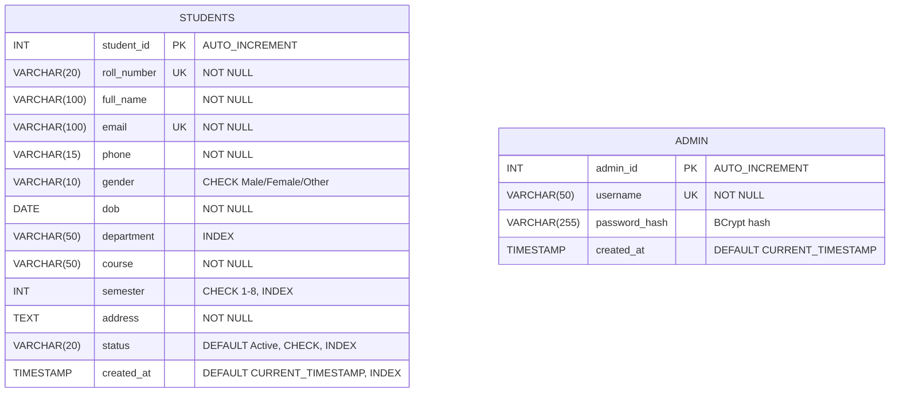

# Database Design

Formal design of `student_registration_db`. For a beginner-friendly explanation of the same design
and of every SQL query, see [DATABASE_EXPLANATION.md](DATABASE_EXPLANATION.md).

## 1. Entity Relationship Diagram

Source: [`diagrams/er-diagram.mmd`](diagrams/er-diagram.mmd) · Image: [`diagrams/exports/er-diagram.png`](diagrams/exports/er-diagram.png)

## 2. Entities

| Entity | Table | Description | Primary key |
|---|---|---|---|
| Student | `students` | A person who registered (or was added by an admin) | `student_id` |
| Administrator | `admin` | A staff account that can log in to the admin panel | `admin_id` |

## 3. Relationships
There is **no foreign-key relationship** between the tables. Administrators act on student records
through the application, but no column stores which administrator created or changed a record. This
keeps the schema minimal for the project scope; an audit trail (a `student_audit` table with foreign
keys to both tables) is a documented future enhancement.

## 4. Data dictionary — `students`

| # | Column | Data type | Null | Key / constraint | Default | Description | Example |
|---|---|---|---|---|---|---|---|
| 1 | `student_id` | INT | No | PK, AUTO_INCREMENT | — | Internal unique ID; shown as `SRS-` + 5 digits | `12` → `SRS-00012` |
| 2 | `roll_number` | VARCHAR(20) | No | UNIQUE `uk_students_roll_number` | — | College roll/registration number, upper case | `23CSE001` |
| 3 | `full_name` | VARCHAR(100) | No | — | — | Student's full name | `Aarav Mehta` |
| 4 | `email` | VARCHAR(100) | No | UNIQUE `uk_students_email` | — | Email, lower case | `aarav.mehta@example.com` |
| 5 | `phone` | VARCHAR(15) | No | — | — | 10-digit mobile number | `9000000001` |
| 6 | `gender` | VARCHAR(10) | No | CHECK `chk_students_gender` | — | `Male`, `Female` or `Other` | `Male` |
| 7 | `dob` | DATE | No | — | — | Date of birth (age 15–60 enforced by the app) | `2005-03-14` |
| 8 | `department` | VARCHAR(50) | No | INDEX `idx_students_department` | — | One of 7 departments | `Computer Science and Engineering` |
| 9 | `course` | VARCHAR(50) | No | — | — | One of 6 courses | `B.E.` |
| 10 | `semester` | INT | No | CHECK `chk_students_semester` (1–8), INDEX | — | Current semester | `3` |
| 11 | `address` | TEXT | No | — | — | Postal address (5–500 characters in the app) | `12 Green Park Colony, Chandigarh` |
| 12 | `status` | VARCHAR(20) | No | CHECK `chk_students_status`, INDEX | `'Active'` | `Active` or `Inactive` | `Active` |
| 13 | `created_at` | TIMESTAMP | No | INDEX `idx_students_created_at` | `CURRENT_TIMESTAMP` | Registration date/time | `2026-11-02 17:34:38` |

## 5. Data dictionary — `admin`

| # | Column | Data type | Null | Key / constraint | Default | Description | Example |
|---|---|---|---|---|---|---|---|
| 1 | `admin_id` | INT | No | PK, AUTO_INCREMENT | — | Internal ID | `1` |
| 2 | `username` | VARCHAR(50) | No | UNIQUE `uk_admin_username` | — | Login name (4–50 letters, digits, `.`, `_`) | `admin` |
| 3 | `password_hash` | VARCHAR(255) | No | — | — | BCrypt hash (60 chars, cost 12) — never the password | `$2a$12$…` |
| 4 | `created_at` | TIMESTAMP | No | — | `CURRENT_TIMESTAMP` | When the account was created | `2026-11-02 17:38:03` |

## 6. Constraints summary

| Constraint | Table | Type | Rule | Enforced against |
|---|---|---|---|---|
| `pk_students` | students | PRIMARY KEY | `student_id` unique, not null | duplicate/missing IDs |
| `uk_students_roll_number` | students | UNIQUE | one row per roll number (case-insensitive collation) | duplicate registrations |
| `uk_students_email` | students | UNIQUE | one row per email (case-insensitive) | duplicate registrations |
| `chk_students_semester` | students | CHECK | `semester BETWEEN 1 AND 8` | impossible semesters |
| `chk_students_status` | students | CHECK | `status IN ('Active','Inactive')` | unknown statuses |
| `chk_students_gender` | students | CHECK | `gender IN ('Male','Female','Other')` | unknown genders |
| `pk_admin` | admin | PRIMARY KEY | `admin_id` unique | — |
| `uk_admin_username` | admin | UNIQUE | one account per username | duplicate admins |
| NOT NULL | both | — | every column required | missing data |

## 7. Indexes

| Index | Column(s) | Created by | Used by |
|---|---|---|---|
| PRIMARY | `students.student_id` | primary key | profile, edit, delete, status (`WHERE student_id = ?`) |
| `uk_students_roll_number` | `roll_number` | unique constraint | duplicate check, roll-number search |
| `uk_students_email` | `email` | unique constraint | duplicate check |
| `idx_students_department` | `department` | explicit | department filter, `GROUP BY department` |
| `idx_students_semester` | `semester` | explicit | semester filter |
| `idx_students_status` | `status` | explicit | status filter, active/inactive counts |
| `idx_students_created_at` | `created_at` | explicit | `ORDER BY created_at DESC` (lists, recent registrations) |
| PRIMARY / `uk_admin_username` | `admin` | constraints | login lookup by username |

## 8. Design explanation

1. **Two tables are enough** for the required features: student data and admin accounts are
   different entities with different attributes.
2. **Surrogate primary key** (`student_id`) instead of using the roll number as the key: roll numbers
   are typed by people and may need correcting; an auto-generated number never changes, so URLs like
   `/admin/students/view?id=12` stay valid after an edit.
3. **Natural keys protected by UNIQUE**: roll number and email still must be unique — enforced by
   the database, not only by Java.
4. **Domain rules in the database** (`CHECK`) as a second line of defence after server-side validation.
5. **Derived values are not stored**: age and the display ID `SRS-00012` are calculated from `dob`
   and `student_id` (3NF; no risk of inconsistency).
6. **Passwords stored only as BCrypt hashes**, in a column named `password_hash` to make that explicit.
7. **utf8mb4 + case-insensitive collation** for international names and case-insensitive uniqueness.
8. **Least-privilege application user**: the app connects as `srs_app` with only
   `SELECT, INSERT, UPDATE, DELETE` on this database (see [SETUP_AND_EXECUTION.md](SETUP_AND_EXECUTION.md#32-create-a-mysql-user-for-the-application-recommended)).

## 9. Normal form analysis
- **1NF** — atomic values; no repeating groups; each row identified by a primary key.
- **2NF** — single-column primary keys, so no partial dependencies.
- **3NF** — no transitive dependencies on non-key attributes (age not stored).
- **Known denormalisation** — `department` and `course` are stored as text values from a fixed list
  instead of foreign keys to lookup tables. Acceptable here because the lists are small, fixed and
  validated in code; normalising them into `departments`/`courses` tables is listed in the future scope.
