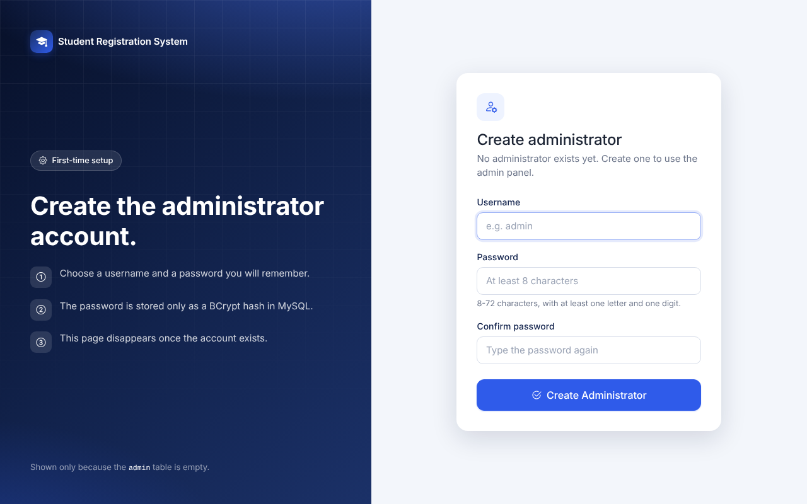

# Start Here

This page explains, in plain words, **what this project is**, **what is already finished**, and **exactly
what you need to do** to run it on your laptop with MySQL Workbench and check that it works.
You don't need to read any other document to get it running.

---

## 1. The project in one minute

**What it is:** a website for a college.
- A **student** opens a form, types their details (name, roll number, email, phone, department …)
  and clicks *Submit*. The details are saved in a **MySQL database**, and the student gets an ID such
  as `SRS-00017`.
- An **administrator** logs in with a password and can see statistics, search students, edit them,
  mark them Active/Inactive, delete them, print a profile and download an Excel (CSV) file.

**How it works (the only picture you need):**
```
 Your browser  ──────>  Java program (runs inside "Tomcat")  ──────>  MySQL database
 (the pages you see)     (checks the data, decides what to do)          (stores the students)
     ▲                                                                      │
     └──────────────────────── the page with the result ◄──────────────────┘
```
MySQL **Workbench** is just a window for *looking at* the database. The database itself is the
**MySQL Server**, which runs in the background.

**Watch it working (1½ minutes):** [demo/student-registration-demo.mp4](demo/student-registration-demo.mp4) —
a recording of the real application: registration, duplicate check, first-time admin setup, dashboard,
search, edit, status change, filter, delete and logout. (The captions were added by the recording
script; everything else is the actual app.)

### What is already done ✅
| Part | Status |
|---|---|
| The website (all pages, design, phone-friendly) | ✅ Finished |
| Saving to MySQL (database scripts + all queries) | ✅ Finished |
| Admin login, security, error messages | ✅ Finished |
| Automatic tests (49 Java tests + 69 website checks) | ✅ All passing |
| Documentation, diagrams, viva guide, report material | ✅ Written (in the `docs` folder) |
| One-click start (`start.bat` / `start.sh`) | ✅ Ready — downloads Maven and Tomcat by itself |

### What you still need to do
1. **Run it on your laptop** — follow section 3 below (about 30–45 minutes the first time).
2. **Check that everything works** — section 4 (10 minutes).
3. **Practise the demonstration** — [VIVA_PREPARATION.md, section F](VIVA_PREPARATION.md#section-f-practical-demonstration).
4. **Take screenshots for your report** — [REPORT_SCREENSHOTS_CHECKLIST.md](REPORT_SCREENSHOTS_CHECKLIST.md).
5. **Send your college's report format** so the final report can be written.

---

## 2. What your laptop needs

| You need | Why | You do NOT need to install |
|---|---|---|
| **Java 17** (JDK) | runs the program | ~~Maven~~ — downloaded automatically |
| **MySQL Server 8** | stores the data | ~~Tomcat~~ — downloaded automatically |
| **MySQL Workbench** (you have it) | lets you see and run SQL | |
| Internet (first start only) | downloads ~35 MB of tools | |

---

## 3. Step by step

### Step 1 — Install Java 17 (skip if you already have it)
1. Check first: open **Command Prompt** (Windows: press `Win`, type `cmd`, Enter) or **Terminal** (Mac)
   and type `java -version`. If it says `17` (or 21), skip to Step 2.
2. Otherwise go to <https://adoptium.net>, download **Temurin 17 (LTS)** for your system and install it.
   **Windows:** in the installer, turn on **"Set JAVA_HOME variable"** and **"Add to PATH"**.
3. Close the window, open a new one, and run `java -version` again.

### Step 2 — Make sure the MySQL Server is installed and running
1. Open **MySQL Workbench**. On its home screen, under **MySQL Connections**, click the tile called
   **Local instance MySQL80** (Windows) or **Local instance 3306** (Mac).
2. Enter your MySQL **root password** → if a query window opens, the server is running. ✅ Go to Step 3.
3. If there is **no tile**, or you get *"Cannot connect"*:
   - **Windows:** download **MySQL Installer** from <https://dev.mysql.com/downloads/installer/>, choose
     **MySQL Server 8.0**, set a **root password** (write it down), keep port **3306**, finish. If MySQL is
     installed but stopped: press `Win`, type *Services*, find **MySQL80**, click **Start**.
   - **Mac:** download **MySQL Community Server 8.0** (DMG) from <https://dev.mysql.com/downloads/mysql/>,
     install it and set a root password; start it from **System Settings → MySQL → Start**.
   - Back in Workbench, click **+** next to *MySQL Connections* if needed: host `localhost`, port `3306`,
     user `root` → **Test Connection**.

> 📝 Remember your MySQL **username** (usually `root`) and **password** — the project asks for them once.

### Step 3 — Download the project
1. Open <https://github.com/Nikhilnmv/PBLJ-Laxita> → green **Code** button → **Download ZIP**.
2. Extract (unzip) it, for example to `Documents\PBLJ-Laxita`.
   (Or with Git: `git clone git@github.com:Nikhilnmv/PBLJ-Laxita.git`.)

### Step 4 — Create the database in MySQL Workbench
1. In Workbench, open your **Local instance** connection (Step 2).
2. **File → Open SQL Script…** → go to the project folder → `database` → choose **`schema.sql`**.
3. Click the **⚡ lightning** button (Execute). The *Output* panel at the bottom shows green ticks.
4. Again **File → Open SQL Script…** → **`sample_data.sql`** → **⚡**. (This adds 16 made-up students.)
5. In the left panel **Navigator → Schemas**, click the small **refresh** arrows. You now see
   **`student_registration_db`** with the tables **`admin`** and **`students`**.
6. Check: open a new query tab and run
   ```sql
   SELECT * FROM student_registration_db.students;
   ```
   You should see **16 rows**. ✅ The database is ready.

### Step 5 — Start the application
**Windows:** open the project folder and **double-click `start.bat`**.
(If Windows shows *"Windows protected your PC"*, click **More info → Run anyway**.)

**Mac:** open Terminal, go to the folder and run it:
```bash
cd ~/Documents/PBLJ-Laxita
```
```bash
./start.sh
```
(If you get *"permission denied"*, run `chmod +x start.sh mvnw` once.)

The **first time** it asks two questions:
```
MySQL username [root]:      ← just press Enter if you use root
MySQL password:             ← type the same password you use in Workbench, press Enter
```
Then it downloads what it needs (a few minutes the first time) and **opens your browser by itself**
at **<http://localhost:8080/student-registration/>**. Keep the black window open — closing it stops
the website. Next time, `start.bat` / `./start.sh` starts in under a minute and asks nothing.

### Step 6 — Create your administrator account (only once)
Click **Admin Login**. Because no administrator exists yet, the app shows this page:



Choose a username (e.g. `admin`) and a password (at least 8 characters, with a letter and a digit),
click **Create Administrator**, then sign in. This page disappears for good after the account exists.

---

## 4. Check that everything works (10 minutes)

Tick each line. Use MySQL Workbench beside the browser to *see* the database change.

| # | Do this | You should see | ✓ |
|---|---|---|---|
| 1 | Open <http://localhost:8080/student-registration/> | The home page with "Register as a Student" | ☐ |
| 2 | **Register**: name `Riya Sen`, DOB `12-04-2005`, Female, roll `26CSE050`, semester 1, Computer Science and Engineering, B.E., email `riya.sen@example.com`, phone `9876512345`, address `21 Lake Road, Kolkata` → **Submit** | "Registration Successful!" and an ID like `SRS-00017` | ☐ |
| 3 | In Workbench run `SELECT * FROM student_registration_db.students ORDER BY student_id DESC LIMIT 1;` | Riya's row — roll number in capitals | ☐ |
| 4 | Register again with roll number `26CSE050` | "This roll number is already registered." | ☐ |
| 5 | Submit the empty form | Red messages under every field | ☐ |
| 6 | **Admin Login** with your account | The dashboard: **17** students | ☐ |
| 7 | **All Students** → search `Riya` | Only Riya in the table | ☐ |
| 8 | Open Riya → **Edit** → semester 2 → **Save Changes** | Green "Changes … were saved"; Workbench shows `semester = 2` after re-running the query | ☐ |
| 9 | **Mark Inactive** | Badge turns red; dashboard *Inactive* goes up by 1 | ☐ |
| 10 | Filter *Department = Computer Science and Engineering* | Only CSE students | ☐ |
| 11 | **Export CSV** | A file `students-<date>.csv` downloads and opens in Excel | ☐ |
| 12 | **Delete** Riya → confirm in the dialog | "Student Riya Sen … was deleted."; the row is gone in Workbench | ☐ |
| 13 | **Log out**, then open <http://localhost:8080/student-registration/admin/dashboard> | You are sent back to the login page | ☐ |

All ticked? 🎉 The project works on your laptop. Stop it with **Ctrl+C** (or close the window).

Want the full automatic check too? With the app running, in **Git Bash** (Windows) or Terminal (Mac):
`ADMIN_PASSWORD='your-admin-password' ./scripts/functional-test.sh` → it should end with
`Result: 69 passed, 0 failed`.

---

## If something goes wrong

| What you see | What it means | What to do |
|---|---|---|
| "Java was not found" | Java isn't installed or not on PATH | Step 1; open a **new** window afterwards |
| A **red box** on the login or setup page: *"Cannot reach the MySQL server…"* | MySQL Server is stopped | Windows: *Services → MySQL80 → Start*. Mac: *System Settings → MySQL → Start*. Reload the page |
| Red box: *"MySQL refused the username or password"* | Wrong password typed in Step 5 | Delete `src\main\resources\db.properties`, run `start.bat` / `./start.sh` again |
| Red box: *"… does not exist yet"* or *"tables are missing"* | Step 4 wasn't done | Run `schema.sql` (and `sample_data.sql`) in Workbench |
| "Something is already running on port 8080" / "Address already in use" | Another program (or an old copy of the app) uses port 8080 | Close other `start.bat` windows, or restart the computer |
| The browser says "This site can't be reached" | The app is still starting, or it stopped with an error | Wait 1–2 minutes; read the last lines in the black window |
| The window closes immediately (Windows) | An error happened before it could pause | Open Command Prompt in the project folder (type `cmd` in the folder's address bar) and run `start.bat` to read the message |
| Forgot the admin password | — | Windows: `mvnw.cmd compile exec:java` · Mac: `./mvnw compile exec:java` → same username → answer `yes` |

**Manual way (if `start.bat` / `start.sh` doesn't work on your computer):**
1. Copy `src\main\resources\db.properties.example` to `db.properties` in the same folder, open it in
   Notepad, and replace `CHANGE_ME` with your MySQL password (and `root` with your username if different). Save.
2. Open Command Prompt / Terminal in the project folder and run
   `mvnw.cmd package cargo:run` (Windows) or `./mvnw package cargo:run` (Mac).
3. When you see `Tomcat 9.0.111 started on port [8080]`, open <http://localhost:8080/student-registration/>.

---

## 5. What to read next
1. [VIVA_PREPARATION.md](VIVA_PREPARATION.md) — what to say, likely questions, the demo script.
2. [COMPLETE_PROJECT_GUIDE.md](COMPLETE_PROJECT_GUIDE.md) — how every part works, explained simply.
3. [CODE_WALKTHROUGH.md](CODE_WALKTHROUGH.md) — what each Java file does.
4. [SETUP_AND_EXECUTION.md](SETUP_AND_EXECUTION.md) — other ways to run it (installed Tomcat, IntelliJ, Eclipse).
