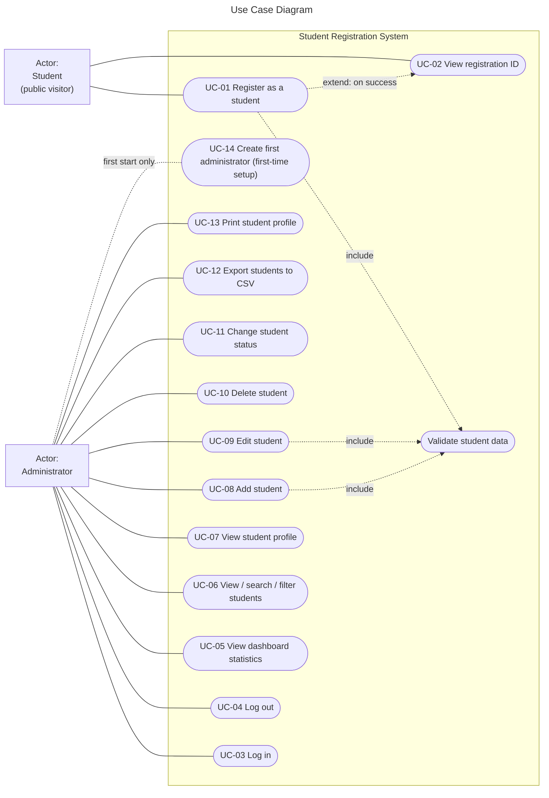

# Use Case Documentation

## 1. Actors

| Actor | Type | Description |
|---|---|---|
| **Student** | Primary, human | Any visitor who wants to register. No account and no login. |
| **Administrator** | Primary, human | College staff member with an account in the `admin` table. |
| **MySQL Database** | Secondary, system | Stores and returns data for every use case except UC-13 (print). |

**Common precondition for UC-04 to UC-13:** the administrator is logged in. `AuthFilter` checks the
session on every `/admin/*` request and redirects to the login page otherwise. For every
data-changing use case (UC-04, UC-08 to UC-11) it also checks the CSRF token.

## 2. Use case diagram

<!-- mermaid:use-case-diagram -->

_Source: [`diagrams/use-case-diagram.mmd`](diagrams/use-case-diagram.mmd) · PNG: [`exports/use-case-diagram.png`](diagrams/exports/use-case-diagram.png) · SVG: [`exports/use-case-diagram.svg`](diagrams/exports/use-case-diagram.svg)_

## 3. Use case list

| ID | Use case | Actor | Main classes |
|---|---|---|---|
| UC-01 | Register as a student | Student | `RegisterServlet`, `StudentDAO` |
| UC-02 | View registration ID | Student | `RegistrationSuccessServlet` |
| UC-03 | Log in | Administrator | `LoginServlet`, `AdminDAO`, `PasswordUtil` |
| UC-04 | Log out | Administrator | `LogoutServlet` |
| UC-05 | View dashboard statistics | Administrator | `DashboardServlet` |
| UC-06 | View / search / filter students | Administrator | `StudentListServlet` |
| UC-07 | View student profile | Administrator | `StudentProfileServlet` |
| UC-08 | Add student | Administrator | `AddStudentServlet` |
| UC-09 | Edit student | Administrator | `EditStudentServlet` |
| UC-10 | Delete student | Administrator | `DeleteStudentServlet` |
| UC-11 | Change student status | Administrator | `StudentStatusServlet` |
| UC-12 | Export students to CSV | Administrator | `ExportStudentsServlet` |
| UC-13 | Print student profile | Administrator | `student-profile.jsp` + browser print |
| UC-14 | Create the first administrator | Installer (first user) | `SetupServlet`, `setup.jsp` |

## 4. Use case descriptions

### UC-01 Register as a student
- **Actor:** Student
- **Preconditions:** The application and MySQL are running.
- **Main flow:**
  1. Student opens `/register`.
  2. System shows the form with drop-downs for department, course and semester.
  3. Student fills in all fields and clicks **Submit Registration**.
  4. Browser checks required fields and formats; the button is disabled to prevent double clicks.
  5. System reads and normalises the data (trim, roll number upper case, email lower case) and sets status Active.
  6. System validates every field and checks that roll number and email are not already registered.
  7. System inserts the record; MySQL generates `student_id` and `created_at`.
  8. System redirects to the success page (UC-02).
- **Alternative flows:**
  - 4a. A field is empty or malformed → the browser highlights it; nothing is sent.
  - 6a. Server validation fails (e.g. JavaScript disabled) → the form is shown again with the entered values and a message under each wrong field.
  - 6b. Roll number or email already registered → message "This roll number / email address is already registered."
  - 7a. Another person registered the same roll number/email a moment earlier → MySQL's UNIQUE constraint rejects the insert → same message as 6b.
  - 7b. Database unavailable → friendly "Something went wrong" page; details are logged.
- **Postconditions:** One new row in `students` with status Active.

### UC-02 View registration ID
- **Actor:** Student
- **Preconditions:** UC-01 completed successfully in this browser.
- **Main flow:** System shows "Registration Successful!", the registration ID (`SRS-000NN`) and a summary; the student may print it.
- **Alternative flow:** The page is refreshed or opened directly → the stored result has already been removed → redirect to the registration form (no duplicate record is created).
- **Postconditions:** The one-time result is removed from the session.

### UC-03 Log in
- **Actor:** Administrator
- **Preconditions:** An admin account exists (created with `AdminSetup`).
- **Main flow:**
  1. Admin opens `/login`, enters username and password, clicks **Sign In**.
  2. System loads the admin by username and verifies the password against the BCrypt hash.
  3. System discards any old session, creates a new one (30-minute timeout), stores the admin and a new CSRF token.
  4. System redirects to the dashboard.
- **Alternative flows:**
  - 1a. Empty fields → "Please enter both username and password."
  - 2a. Unknown username or wrong password → "Invalid username or password." (same message for both).
  - 2b. Database unavailable → "Cannot reach the MySQL server on localhost:3306. Make sure MySQL is running …" (DBConnection.explain gives a specific hint)
  - 1b. Admin is already logged in and opens `/login` → redirected straight to the dashboard.
- **Postconditions:** An authenticated session exists.

### UC-04 Log out
- **Main flow:** Admin clicks **Log out** (POST with CSRF token) → session invalidated → redirect to the login page with "You have been logged out successfully."
- **Alternative flow:** Token missing/invalid → 403 page; the session stays active.
- **Postconditions:** The session no longer exists; admin pages redirect to login; Back button shows no cached admin data.

### UC-05 View dashboard statistics
- **Main flow:** Admin opens `/admin/dashboard` → system runs the count queries → shows total, active (with %), inactive (with %), departments, five recent registrations and per-department bars.
- **Alternative flow:** No students → zeros, and an empty state "No registrations yet".
- **Postconditions:** None (read-only).

### UC-06 View / search / filter students
- **Main flow:**
  1. Admin opens **All Students** → newest 10 students and page links.
  2. Admin types a name, roll number or email and/or chooses department, semester, status → **Apply**.
  3. System shows matching students and "Showing X–Y of N".
- **Alternative flows:** No matches → "No students match your search" with a **Clear filters** button; page number too large → last page is shown.
- **Postconditions:** None (read-only). The filter is part of the URL and can be bookmarked.

### UC-07 View student profile
- **Main flow:** Admin clicks a name → system shows personal, academic, contact and registration details with Edit, status, Print and Delete actions.
- **Alternative flow:** ID missing, invalid or deleted → 404 "Page not found".

### UC-08 Add student
- **Main flow:** Admin opens **Add Student**, fills the form (including status), saves → system validates, inserts, shows the new profile with "Student … was added with registration ID SRS-…".
- **Alternative flows:** As UC-01 6a/6b/7a; missing CSRF token → 403.
- **Postconditions:** New row in `students`.

### UC-09 Edit student
- **Main flow:** Admin clicks **Edit** → form pre-filled → changes values → **Save Changes** → system validates (duplicate checks ignore this student's own values) → `UPDATE` → profile with "Changes to … were saved."
- **Alternative flows:** Validation/duplicate error → form with messages; student deleted meanwhile → "This student no longer exists."; missing token → 403.
- **Postconditions:** Row updated in `students`.

### UC-10 Delete student
- **Main flow:** Admin clicks **Delete** → confirmation dialog shows the name and roll number → admin confirms → POST → `DELETE` → list with "Student … was deleted."
- **Alternative flows:** Admin cancels → nothing happens; student already deleted → "Student not found. It may already have been deleted."; GET request → 405; missing token → 403.
- **Postconditions:** Row removed from `students`; dashboard counts decrease.

### UC-11 Change student status
- **Main flow:** On the profile, admin clicks **Mark Inactive** / **Mark Active** → POST → `UPDATE students SET status = ?` → profile with "Status changed to …".
- **Alternative flow:** Invalid status value or ID → "Invalid status change request."
- **Postconditions:** Status updated; dashboard active/inactive counts change.

### UC-12 Export students to CSV
- **Main flow:** Admin clicks **Export CSV** (optionally after filtering) → browser downloads `students-YYYY-MM-DD.csv` with all matching students.
- **Postconditions:** None in the database.

### UC-13 Print student profile
- **Main flow:** Admin clicks **Print** on a profile (or a student on the success page) → browser print dialog with a clean layout (no menus or buttons).

### UC-14 Create the first administrator (first-time setup)
- **Actor:** the person installing the system.
- **Preconditions:** the `admin` table is empty.
- **Main flow:** open the application's login page → redirected to `/setup` → enter username, password
  and confirmation → system validates, stores a BCrypt hash, redirects to the login page with
  "Administrator account created. Please sign in."
- **Alternative flows:** invalid username / weak password / passwords differ → messages under the
  fields; database problem → hint such as "Make sure MySQL is running"; an admin already exists →
  `/setup` redirects to `/login` (the page is closed for good).
- **Postconditions:** one row in `admin`.
