# Diagrams

All diagrams are written in **Mermaid**, a text format that GitHub renders automatically. The `.mmd` files in this
folder are the editable sources; `exports/` contains PNG (for Word/PDF reports) and SVG (scalable) versions.
Every diagram uses the real class, method, URL and table names from the code.

## How to edit and re-export

1. Edit the `.mmd` file (any text editor). Preview it at <https://mermaid.live> (paste the text) or with the
   Mermaid plugin of IntelliJ IDEA / VS Code.
2. Re-export (needs Node.js; run from the project folder):
   ```bash
   npx -p @mermaid-js/mermaid-cli mmdc -i docs/diagrams/er-diagram.mmd -o docs/diagrams/exports/er-diagram.png -b white -s 2
   ```
   Or click **Actions → PNG/SVG** on mermaid.live and save the file into `exports/`.
3. If the diagram is also shown inside another document (e.g. ARCHITECTURE.md), copy the new text there too.

## Index

| # | Diagram | Source | PNG | SVG |
|---|---|---|---|---|
| 1 | [High-level system architecture](#1-high-level-system-architecture) | [`architecture.mmd`](architecture.mmd) | [png](exports/architecture.png) | [svg](exports/architecture.svg) |
| 2 | [MVC + DAO architecture](#2-mvc--dao-architecture) | [`mvc-architecture.mmd`](mvc-architecture.mmd) | [png](exports/mvc-architecture.png) | [svg](exports/mvc-architecture.svg) |
| 3 | [Component diagram](#3-component-diagram) | [`component-diagram.mmd`](component-diagram.mmd) | [png](exports/component-diagram.png) | [svg](exports/component-diagram.svg) |
| 4 | [Deployment diagram](#4-deployment-diagram) | [`deployment-diagram.mmd`](deployment-diagram.mmd) | [png](exports/deployment-diagram.png) | [svg](exports/deployment-diagram.svg) |
| 5 | [Request–response lifecycle](#5-requestresponse-lifecycle) | [`request-lifecycle.mmd`](request-lifecycle.mmd) | [png](exports/request-lifecycle.png) | [svg](exports/request-lifecycle.svg) |
| 6 | [Use case diagram](#6-use-case-diagram) | [`use-case-diagram.mmd`](use-case-diagram.mmd) | [png](exports/use-case-diagram.png) | [svg](exports/use-case-diagram.svg) |
| 7 | [Class diagram](#7-class-diagram) | [`class-diagram.mmd`](class-diagram.mmd) | [png](exports/class-diagram.png) | [svg](exports/class-diagram.svg) |
| 8 | [Sequence diagram – Student registration](#8-sequence-diagram--student-registration) | [`registration-sequence.mmd`](registration-sequence.mmd) | [png](exports/registration-sequence.png) | [svg](exports/registration-sequence.svg) |
| 9 | [Sequence diagram – Admin login and logout](#9-sequence-diagram--admin-login-and-logout) | [`login-sequence.mmd`](login-sequence.mmd) | [png](exports/login-sequence.png) | [svg](exports/login-sequence.svg) |
| 10 | [Sequence diagram – Student management](#10-sequence-diagram--student-management) | [`student-management-sequence.mmd`](student-management-sequence.mmd) | [png](exports/student-management-sequence.png) | [svg](exports/student-management-sequence.svg) |
| 11 | [Activity diagram – Student registration](#11-activity-diagram--student-registration) | [`activity-registration.mmd`](activity-registration.mmd) | [png](exports/activity-registration.png) | [svg](exports/activity-registration.svg) |
| 12 | [Activity diagram – Admin management](#12-activity-diagram--admin-management) | [`activity-admin-management.mmd`](activity-admin-management.mmd) | [png](exports/activity-admin-management.png) | [svg](exports/activity-admin-management.svg) |
| 13 | [Entity relationship diagram](#13-entity-relationship-diagram) | [`er-diagram.mmd`](er-diagram.mmd) | [png](exports/er-diagram.png) | [svg](exports/er-diagram.svg) |
| 14 | [DFD Level 0 – Context diagram](#14-dfd-level-0--context-diagram) | [`dfd-level-0.mmd`](dfd-level-0.mmd) | [png](exports/dfd-level-0.png) | [svg](exports/dfd-level-0.svg) |
| 15 | [DFD Level 1 – Main processes](#15-dfd-level-1--main-processes) | [`dfd-level-1.mmd`](dfd-level-1.mmd) | [png](exports/dfd-level-1.png) | [svg](exports/dfd-level-1.svg) |

## 1. High-level system architecture

Browser, Tomcat (filter, servlets, JSP, DAO, utilities, model) and MySQL.

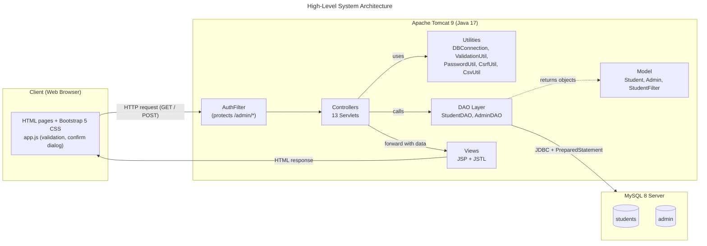

## 2. MVC + DAO architecture

The eight steps from request to HTML across Controller, DAO, Model and View.

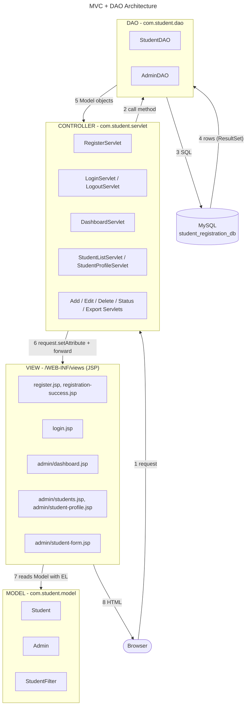

## 3. Component diagram

Web components, data/utility components, setup tool, driver, configuration and database.

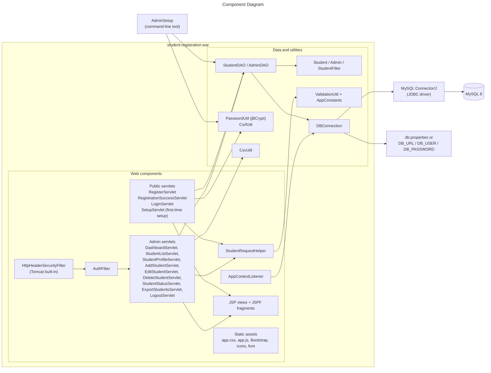

## 4. Deployment diagram

Everything on one laptop: browser, Tomcat on 8080, MySQL on 3306.

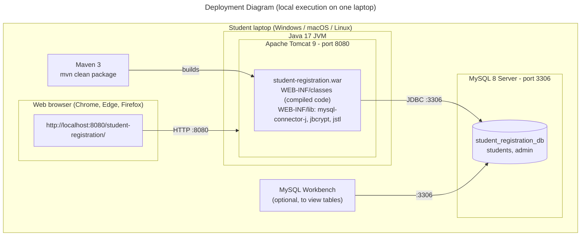

## 5. Request–response lifecycle

Sequence of one admin request through filter, servlet, DAO, MySQL and JSP.

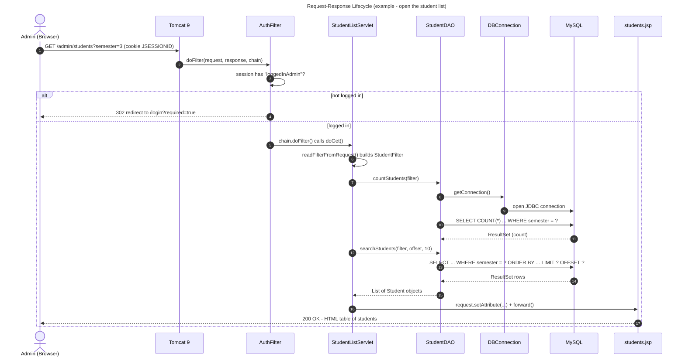

## 6. Use case diagram

Student and Administrator use cases UC-01 to UC-13.

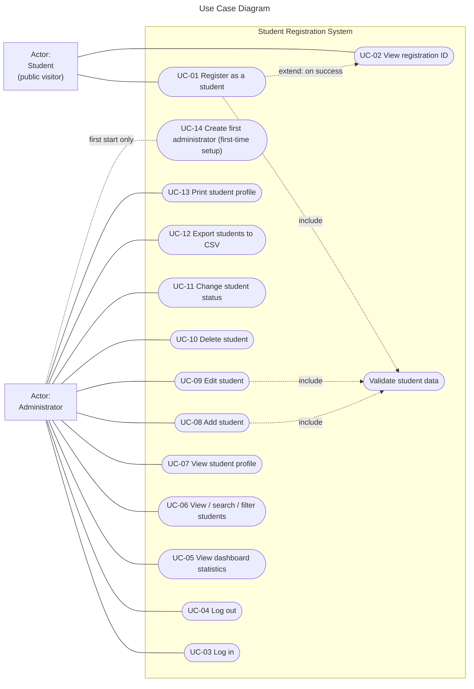

## 7. Class diagram

Main classes, inheritance, interfaces and dependencies.

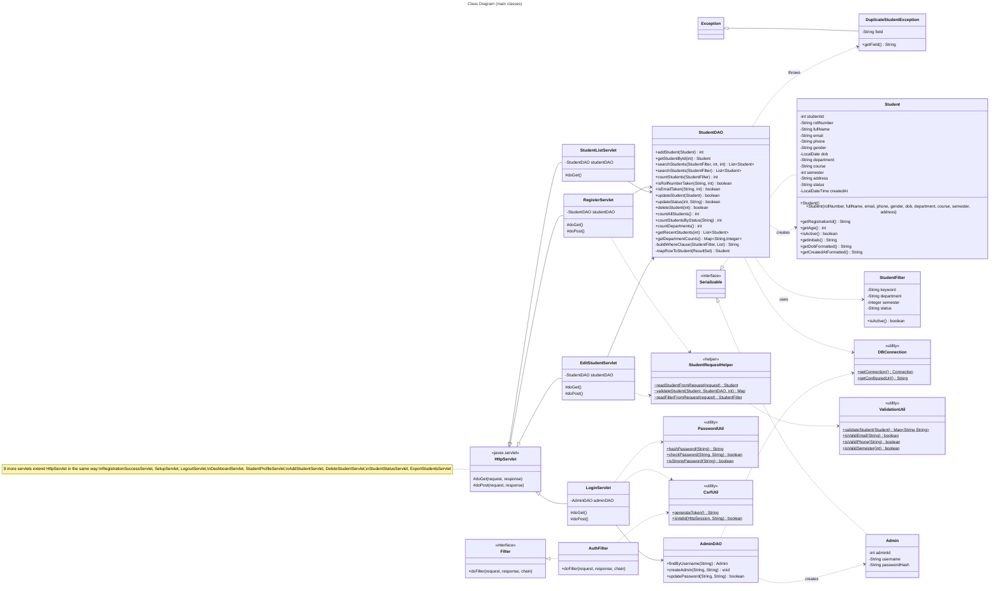

## 8. Sequence diagram – Student registration

From GET /register to the success page, with error and race-condition alternatives.

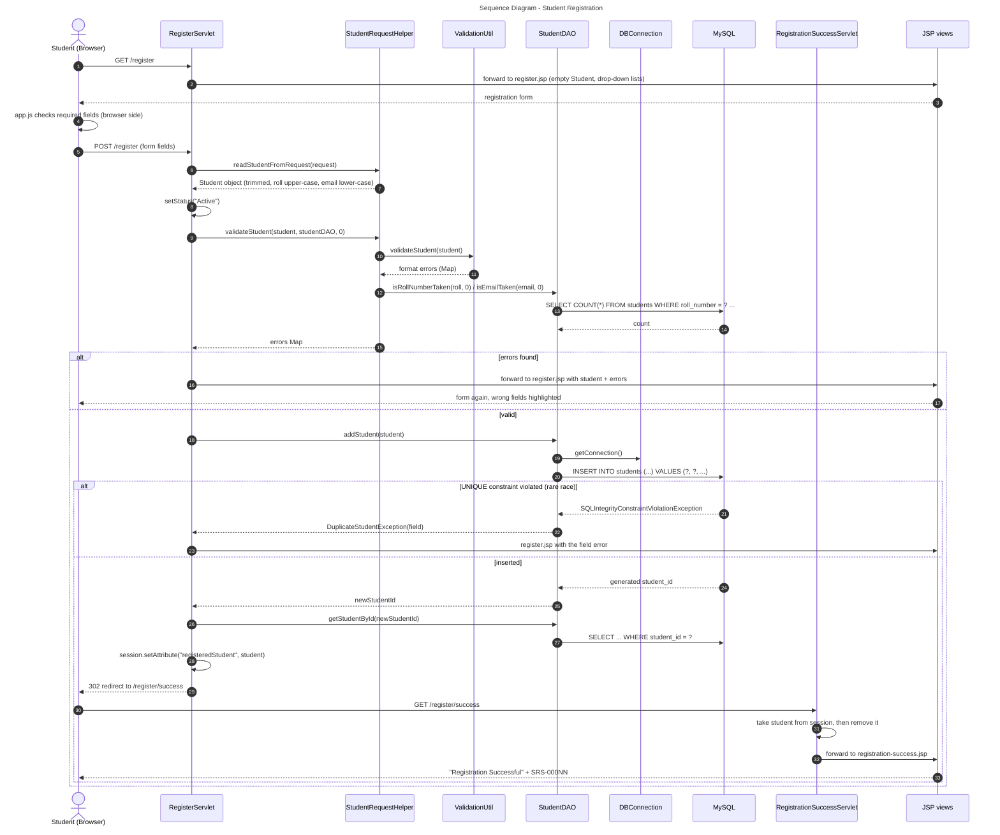

## 9. Sequence diagram – Admin login and logout

BCrypt check, session and CSRF token creation, filter, logout.

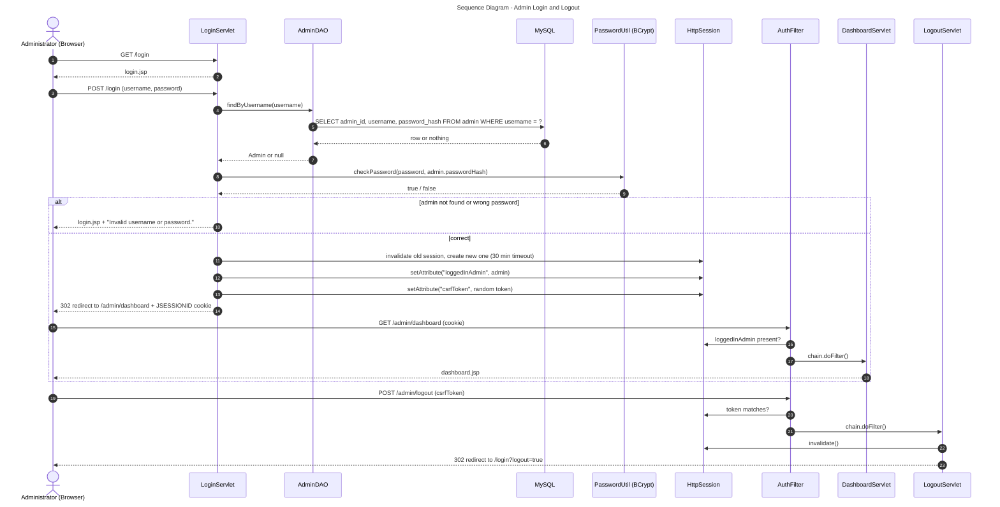

## 10. Sequence diagram – Student management

Search, edit and delete.

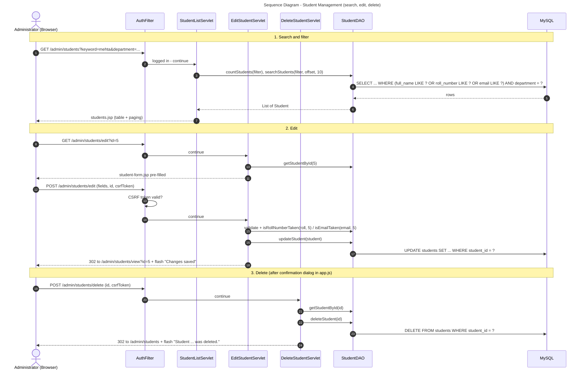

## 11. Activity diagram – Student registration

Decision points of the registration process.

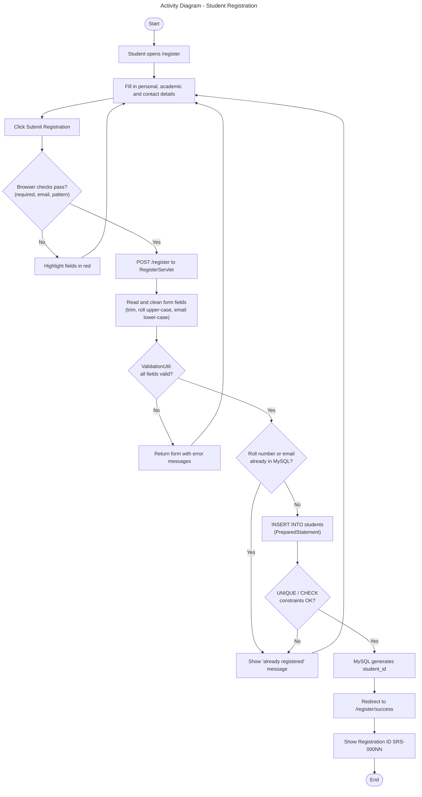

## 12. Activity diagram – Admin management

Login loop and all administrative actions.

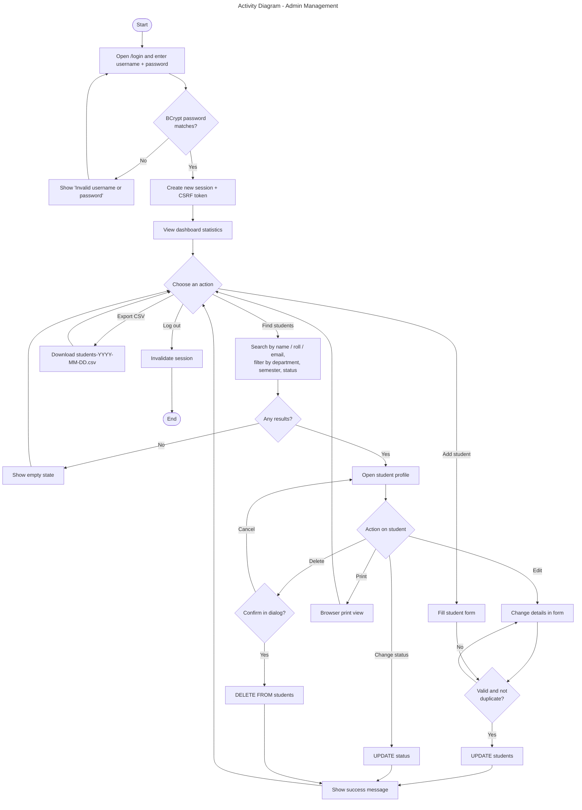

## 13. Entity relationship diagram

Tables students and admin with keys and constraints.

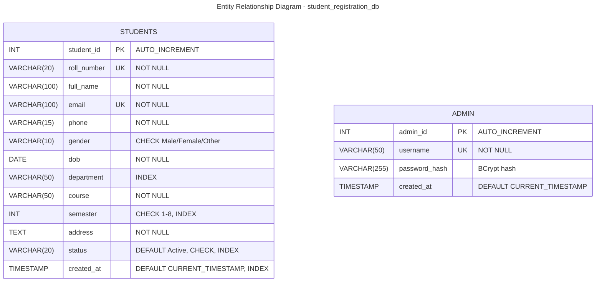

## 14. DFD Level 0 – Context diagram

The system as one process with its two external entities.

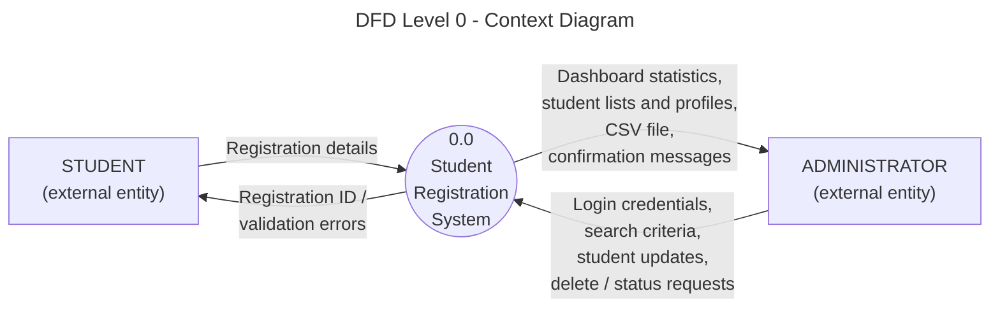

## 15. DFD Level 1 – Main processes

Six processes and three data stores.

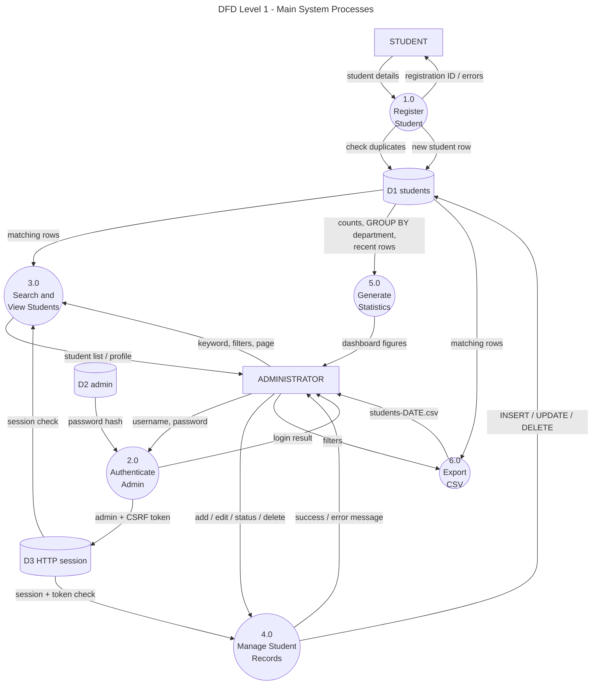
